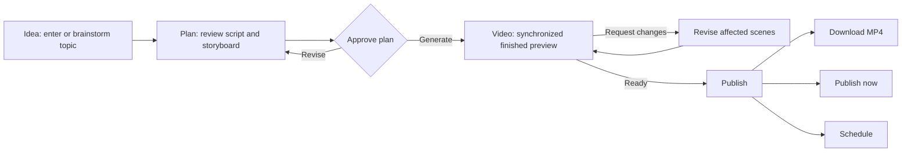
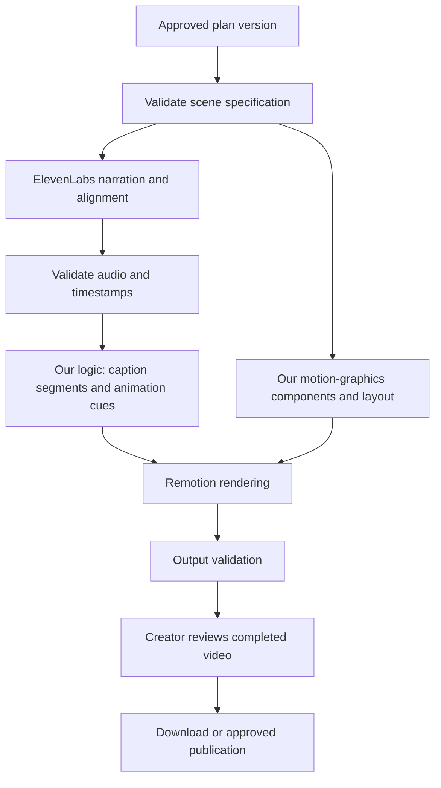

# Business Requirements Document — AI Educational Explainer Studio

**Version:** 1.2 — hosted portfolio and Supabase stack  
**Prepared:** 18 October 2026  
**Updated:** 19 October 2026  
**Product name:** Working title; final name is not yet selected  
**Release:** V1  
**Status:** Draft BRD; implementation has not started

**Implementation baseline:** The consolidated [final PRD](PRD.md) now defines screen behavior, data/API requirements, acceptance, and current defaults. Use it where earlier BRD proposals differ.

## 0. Governing portfolio scope

The user has clarified that this is a **portfolio/resume project with a strict $0 budget**, not a production business application. [Project constraints](PROJECT_CONSTRAINTS.md) define the current budget, architecture, free-tier evaluation, and demo-mode rules. They take precedence over earlier commercial/production assumptions in this BRD.

The four-stage educational-video experience remains the core. The [selected architecture](ARCHITECTURE.md) is Next.js/TypeScript/Node.js on Vercel Hobby, Supabase Auth/Postgres/Storage, Inngest Free for workflows/scheduling, and Remotion with Vercel Sandbox for hosted rendering. Gemini and ElevenLabs remain the AI providers. Supabase replaces Better Auth, MongoDB, R2, and GCS. The project needs a public resume URL and quota-limited hosted generation; local rendering is a development/fallback option. Clearly labeled samples remain available when quotas are exhausted. Live Instagram publication still depends on Meta access and is optional; no paid infrastructure is permitted. Simulation must never be represented as real generation or publication.

Production service-level targets, multi-user scale, elaborate operations, and commercial pilot goals below are design context or deferred evaluation targets, not obligations for the portfolio release. Preserve appropriate validation, ownership/security checks, useful error handling, autosave, and meaningful tests.

## 1. Purpose and decision status

This document defines the business scope, user experience, functional requirements, operating requirements, exception behavior, and acceptance criteria for V1 of an AI educational video creation product. It is the baseline for a subsequent PRD, technical design, and implementation plan.

The product converts a creator's topic into a 60–90 second educational motion-graphics explainer with AI narration and synchronized captions. Users approve a combined script and storyboard, review the finished video, and download it or publish it to Instagram. The visible workflow has four steps: **Idea → Plan → Video → Publish**.

Requirements marked **Confirmed** reflect decisions agreed in the product discussion. Requirements marked **Proposed default** are recommendations that make this BRD actionable but have not been individually approved. Items marked **Open decision** need resolution before the affected implementation or production launch. Including an item in this draft does not imply stakeholder approval of a proposed default.

This is a BRD with detailed functional coverage. It does not prescribe database schemas, API contracts, prompts, queue technology, infrastructure vendors, sprint estimates, or a final deployment architecture.

## 2. Business opportunity and product proposition

### 2.1 Problem

Creators with useful knowledge face several separate tasks before they can publish a clear explainer: choose an angle, write concise narration, plan visuals, animate concepts, produce speech, time captions, render the video, and publish it. These tasks create effort and require skills that many educators and subject experts do not have.

Generic video output is insufficient when a topic needs readable labels, clear diagrams, causal relationships, and narration that matches the animation. A creator also needs to correct one part without repeatedly rebuilding everything.

### 2.2 Product proposition

**Turn an idea into a clear, narrated educational motion-graphics video through a simple AI-assisted workflow.**

The product handles production complexity internally. Creators retain control over the explanation and final publication without operating a professional timeline editor.

### 2.3 Intended differentiation

- Educational clarity: one clear learning objective and a coherent explanation.
- Visual explanation: motion graphics explain relationships and processes rather than merely decorate narration.
- Narration-driven timing: captions and animation events follow actual speech timing.
- Low-friction revision: conversational changes to the plan or selected scenes.
- Complete workflow: a usable export and optional approved Instagram publication.

These are product goals to validate with output samples and pilot users, not established competitive advantages or promises of commercial success.

## 3. Business objectives and success measures

### 3.1 Objectives

| ID | Objective | Business evidence |
|---|---|---|
| BO-01 | Reduce the effort required to create an educational explainer | Active editing time, revision count, and user interviews |
| BO-02 | Produce videos users consider clear and publishable | Creator approval, rubric-based quality review, export/publication rate |
| BO-03 | Demonstrate a repeatable creator workflow | Reviewer can resume, revise, and complete multiple sample projects |
| BO-04 | Make generation and scheduling trustworthy | Completion, recovery, synchronization, and publishing reliability |
| BO-05 | Demonstrate within a strict $0 budget | Verified free plans, bounded usage, local rendering, and no paid fallback |

### 3.2 Proposed pilot measures

For the portfolio release, use three representative educational topics and a small number of reviewer sessions. Demonstrate the end-to-end local workflow, both layouts, timing correctness, practical failure handling, and clear setup documentation. Commercial traction, customer acquisition, and paid pilots are not acceptance requirements.

Collect time to approved plan, time to first preview, active correction time, successful export rate, first-pass approval, revision causes, caption errors, published-post success, and user-reported explanation quality. Report AI wait time separately from active creator effort.

Customer billing and monetization are outside V1. Use simple logs, request/character counters, and provider dashboards to protect free allowances; a custom cost analytics system is unnecessary.

## 4. Audience and stakeholders

### 4.1 Primary users

- Educational creators explaining concepts to a social audience.
- Educators, coaches, and subject experts producing short lessons.
- Individual brand representatives creating educational product or industry explanations.

V1 uses a single-creator experience for all these users. It does not include agency workspaces, multi-seat collaboration, classroom management, or enterprise approval hierarchies.

### 4.2 Stakeholders

| Stakeholder | Responsibility |
|---|---|
| Product owner | Approve scope, quality targets, defaults, and release readiness |
| Creator | Provide the topic, review content, approve the plan and finished video |
| Engineering | Implement pipeline, timing, rendering, persistence, and integration reliability |
| Design | Maintain the four-step experience and readable visual output |
| Operations/support | Diagnose failures and support account or publishing recovery |
| AI providers | Supply text generation and narration capabilities under their terms |
| Meta/Instagram | Authorize connected-account access and accept supported publications |

The operations role is internal. A separate customer-facing admin dashboard is not a V1 commitment.

## 5. Confirmed product decisions

| Topic | Confirmed direction |
|---|---|
| Content | Educational explainers |
| Visual approach | Motion graphics synchronized with AI narration |
| User workflow | Four visible steps; no separate script stage |
| Plan | Combined script and storyboard with creator approval |
| Length | 60–90 seconds by default; optional target-length control |
| Layout | Vertical 9:16 and horizontal 16:9 |
| Captions | Included, synchronized, and editable |
| Revisions | Conversational changes to plan and video |
| Delivery | Finished-video preview and 1080p MP4 download |
| Social integration | Instagram workflow retained; live publishing/scheduling optional under portfolio constraints |
| Persistence | Saved projects, autosave, progress, and recoverable generation |
| Planning provider | Gemini API as the initial candidate; provider choice remains replaceable |
| Narration | ElevenLabs |
| Timing | ElevenLabs timing data plus our own caption and animation synchronization logic |
| Rendering | Remotion with our own motion-graphics and layout logic |
| Budget and purpose | $0 public portfolio application; quota-limited hosted generation and local fallback |
| Application/hosting | Next.js, TypeScript, Node.js endpoints, Vercel Hobby |
| Identity/data/media | Supabase Auth, Postgres, and Storage |
| Hosted workflow/rendering | Inngest Free coordination; Remotion in Vercel Sandbox |
| Excluded | Branding tools, subscriptions, billing, paid infrastructure, and enterprise operations |

No separate transcription or alignment provider is part of the agreed V1 pipeline. The platform must handle missing or invalid ElevenLabs alignment through recovery, not silently add a new provider.

## 6. Scope boundaries

### 6.1 Included

1. Authentication and a personal project dashboard.
2. Conversational idea planning with optional audience, tone, and reference notes.
3. Combined AI-generated script and storyboard.
4. Plan approval before full narration and rendering.
5. Educational motion-graphics composition and generation.
6. AI narration and actual-audio-based synchronization.
7. Editable synchronized captions.
8. Vertical and horizontal layouts.
9. Conversational revisions and targeted scene regeneration.
10. Preview, 1080p MP4 export, and download.
11. Instagram connection/publishing/scheduling workflow and status; real integration optional for the portfolio release and clearly distinguished from demo simulation.
12. Autosave, version tracking, retries, and failure recovery.
13. Minimal diagnostics and free-quota safeguards; no custom cost dashboard.

### 6.2 Excluded

- Logos, brand kits, custom brand fonts, saved brand colors, and branded intros/outros.
- Subscriptions, payment collection, paywalls, credit wallets, invoices, and user usage dashboards.
- A professional timeline editor, keyframe editor, or manual animation authoring interface.
- Photorealistic cinematic generation as the core visual engine.
- Avatars, voice cloning, complex character performance, and lip synchronization.
- Long-form videos exceeding the initial duration policy.
- Fully unattended idea-to-publication automation or recurring content generation.
- Social channels other than Instagram; social performance analytics and recommendations.
- Team collaboration, multi-organization workspaces, agency account management, and reviewer roles.
- Automatic PDF/PPT ingestion, webpage crawling, article scraping, and bulk content imports.
- Training a foundation model or building a proprietary text-to-speech model.
- Background music generation, a licensed music catalogue, or advanced audio mixing. Narration is sufficient for V1.

Excluding branding controls does not exclude an internally defined, visually consistent design system. The product still needs coherent typography, colors, and animation behavior.

## 7. Experience principles and application structure

### 7.1 Principles

- Use four workflow stages, with progress and errors shown inside the current stage.
- Put audience, voice, tone, format, and optional length settings behind compact controls with defaults.
- Present script and storyboard together; never require duplicate approval screens.
- Preserve work across refresh, navigation, disconnection, and recoverable failures.
- Explain the effect of a revision before it replaces an approved or scheduled version.
- Show real status rather than invented completion percentages or unsupported delivery estimates.
- Make final video approval and external publishing intentional actions.

### 7.2 Minimal navigation

**Proposed default:** three top-level destinations: Projects, New video, and Settings. Settings contains account and Instagram connection management. Publishing history and scheduled posts can be shown within projects with a dashboard filter; a separate social management product is unnecessary.

### 7.3 Four-stage overview

| Stage | Creator sees | Primary action | Completion condition |
|---|---|---|---|
| Idea | Topic field and AI planning conversation | Create plan | AI has enough information to draft a coherent explainer |
| Plan | Scene cards with narration and visual/animation direction | Approve & generate | A specific plan version is approved |
| Video | Generation progress, finished preview, captions, revision input | Ready to publish | Creator marks a completed render as ready |
| Publish | Download, account, post caption, publish/schedule controls | Download / Publish / Schedule | Export is delivered or publication outcome is recorded |

The creator may navigate backward. Going backward does not automatically invalidate an approval; changing its underlying content does.

The revision loop illustrates local changes. Changes to the core explanation return to Plan as specified in UF-05.

## 8. Detailed user flows

### UF-01 — First visit and first project

1. User signs up or signs in.
2. An empty dashboard offers one clear Create video action.
3. User enters the Idea stage without mandatory onboarding questionnaires.
4. A project is created and saved when meaningful content is entered.
5. The user can leave and resume the saved draft.

**Acceptance:** Instagram connection and billing are not prerequisites to creating or exporting a video.

### UF-02 — Enter or brainstorm an idea

1. Creator enters a topic, rough explanation, or brainstorming request.
2. AI helps narrow the topic and identify a learning objective.
3. Creator may supply audience, tone, reference notes, format, and target length.
4. Missing optional preferences receive defaults rather than mandatory questions.
5. AI asks a concise clarification only when proceeding would produce materially different explanations or an incoherent topic.
6. Creator chooses Create plan.

**Proposed defaults:** beginner audience, clear/friendly tone, vertical format, English, a standard narrator voice, and automatic 60–90 second length. Language and voice availability must be validated before launch.

An open-ended request such as “something about physics” should produce a small set of concrete topic ideas. A request such as “explain gravity to a ten-year-old” can proceed directly.

### UF-03 — Review combined storyboard and script

1. AI proposes a hook, explanation, example where useful, and takeaway.
2. The Plan stage shows ordered scene cards.
3. Each card contains narration, on-screen text, a representative visual layout, an animation description, and an estimated duration.
4. Creator edits narration directly or requests a conversational change to a scene or the whole plan.
5. AI updates affected cards and the overall duration estimate.
6. Creator approves the current plan and starts generation in one action.

Plan visuals are representative previews, not a promise that a final rendered frame already exists. The interface must clearly distinguish estimated timing from timing measured from narration audio.

### UF-04 — Generate and preview

1. System records the approved plan version and creates one logical generation job.
2. System validates that requested visuals can be represented by available components.
3. System generates scene narration with ElevenLabs and receives alignment data.
4. System calculates caption segments, scene timing, and animation cues.
5. System renders the selected layout and validates the output.
6. Creator receives a playable finished preview with the ability to seek and pause.
7. Creator either revises it or marks the render ready.

The visible generation sequence can be: Preparing scenes → Creating voiceover → Synchronizing → Rendering → Checking video → Ready. Internal subtasks do not become additional workflow steps.

### UF-05 — Revise a video conversationally

1. Creator submits a request, optionally targeting a scene.
2. AI interprets its scope and asks for clarification only if it cannot safely identify the intended change.
3. System creates a new draft revision and identifies affected artifacts.
4. Narration changes require new audio, timing, captions, and dependent animation timing for affected scenes.
5. Visual-only changes reuse narration when valid; caption-display corrections can preserve audio.
6. System renders a new version and presents it for review.
7. Prior completed output remains recoverable.

If the request changes the learning objective or substantially restructures the explanation, return the revised combined plan for approval before generating the replacement video. Small visual adjustments can generate a new preview without repeating the complete plan stage.

### UF-06 — Export and download

1. Creator selects a completed, reviewed version and layout.
2. System provides the 1080p MP4.
3. Download failure permits retry without regenerating the video.
4. User may return later to download the same stored artifact while it is retained.

Vertical export is 1080 × 1920; horizontal export is 1920 × 1080. Both are composed for their layout rather than mechanically cropped.

**Proposed default:** each generation produces the chosen format. Requesting the other format reuses the approved content and narration but performs layout and render work; simultaneous double rendering is not required. The alternate layout needs review before publication.

### UF-07 — Connect Instagram

1. Creator chooses Connect Instagram from Settings or Publish.
2. System explains account eligibility and requested publishing access.
3. Creator completes Meta's authorized connection flow.
4. System verifies and displays the connected account identity and connection state.
5. User returns to the project or Settings without losing work.

**Proposed default:** one connected Instagram professional account per user in V1. Provider access and account eligibility must be verified against the current API during the integration design.

Denied consent, an ineligible account, expired authorization, or an interrupted connection must leave the project usable for download.

### UF-08 — Publish now

1. Creator enters Publish for a reviewed render.
2. System shows the exact video version, destination account, suggested editable post caption, and selected layout.
3. System checks media validity and connection health.
4. Creator selects Publish now.
5. System submits the publication and tracks asynchronous processing.
6. On confirmed success, system records the external post ID and provides a link where available.
7. On failure or uncertain outcome, system shows the appropriate recovery state.

**Proposed Instagram format policy:** publish a reviewed vertical version in V1. A horizontal project remains downloadable and can generate a vertical adaptation through the same workflow. Do not silently crop or publish an unreviewed adaptation. This is a product simplification, not a claim that Instagram universally rejects horizontal media.

### UF-09 — Schedule publication

1. Creator chooses a date, time, and time zone for a reviewed render.
2. System validates that the time is in the future and displays the resolved time zone/offset.
3. Creator confirms Schedule.
4. System pins the rendered version, caption, account, and scheduled instant.
5. At the due time, the server checks eligibility and submits the publication without requiring an open browser.
6. Status updates to publishing, published, failed, or needs attention as appropriate.

Creator can reschedule or cancel while the job is still pending. Once publication submission has started, cancellation is best-effort and must not be reported as successful until confirmed. Cancellation of a pending job does not delete the rendered video.

### UF-10 — Resume or recover

1. User opens a saved project after navigating away or refreshing.
2. System loads the latest persisted draft, last approved plan, and latest completed output.
3. If a job is running, the user reconnects to its status rather than creating another job.
4. If a stage failed, a contextual recovery action resumes or retries the affected work.
5. A previous completed render remains available while a replacement is being generated.

## 9. Functional requirements and acceptance criteria

All requirements below are V1 requirements unless explicitly marked proposed or open.

**Portfolio qualification:** FR-17–FR-19 live Instagram checks are optional extensions; label simulated publication honestly. Hosted scheduling/workflow coordination uses Inngest Free with saved Supabase state. FR-20–FR-22 require practical recovery, version consistency, and quota safeguards, not enterprise infrastructure. Free service pauses and exhausted quotas can interrupt jobs; no guaranteed scheduled delivery is implied.

| ID | Requirement | Acceptance criterion |
|---|---|---|
| FR-01 | Authenticate users and isolate their projects | A user cannot read, modify, render, or publish another user's project through UI or direct requests |
| FR-02 | Show project state and resume location | Dashboard distinguishes draft, generating, ready, scheduled, failed, and published outcomes without treating them as one linear state |
| FR-03 | Autosave meaningful edits and chat state | Saved edits reappear after reload; save failures are visible and never labeled Saved |
| FR-04 | Support conversational idea refinement | User can start with an idea or ask for ideas and produce an editable brief |
| FR-05 | Generate one combined plan | Scene cards include narration, visual direction, animation direction, on-screen text, and estimated timing |
| FR-06 | Support direct and conversational plan edits | User can change one scene or all scenes; affected estimates and approval status update |
| FR-07 | Gate full generation on approval | Generation uses an explicitly approved plan version, not a changing unsaved draft |
| FR-08 | Generate explanatory motion graphics | In agreed test topics, visual events explain the narrated concept and use supported renderable elements |
| FR-09 | Generate narration through ElevenLabs | Correct voice settings and narration version are recorded; returned audio is decodable |
| FR-10 | Use ElevenLabs alignment for synchronization | Caption and animation timing is derived from actual narration alignment rather than estimated word counts |
| FR-11 | Produce synchronized editable captions | Every spoken section is represented; display edits persist; wrapping respects layout bounds |
| FR-12 | Support both aspect ratios | A readable 1080p output can be produced in each format without stretching or blindly cropping content |
| FR-13 | Offer simple optional creative controls | Defaults allow immediate planning; format, voice, tone, and target length are editable without additional stages |
| FR-14 | Provide conversational video revisions | Targeted requests produce a new reviewable version; the prior render is not overwritten mid-job |
| FR-15 | Preview the finished output | Preview uses a completed video artifact or a version-identical composition and supports playback controls |
| FR-16 | Export MP4 | Downloaded file has correct dimensions, playable audio/video, synchronized captions, and no truncated ending |
| FR-17 | Connect and disconnect Instagram | Account identity and health are visible; disconnection prevents future submissions and flags pending schedules |
| FR-18 | Publish immediately | System records confirmed success or an actionable failure; repeated clicks do not create accidental duplicate posts |
| FR-19 | Schedule, reschedule, and cancel | A pending job runs server-side at its saved instant and uses the pinned reviewed artifact |
| FR-20 | Expose reliable job progress and recovery | Refresh does not duplicate a job; recoverable errors have a valid next action |
| FR-21 | Preserve version relationships | Plan, narration, timing, captions, render, and publication are traceable to compatible revisions |
| FR-22 | Record internal health and costs | Operations can attribute provider calls, retries, and renders to jobs without a customer billing interface |

## 10. AI and production pipeline

### 10.1 Initial tools and responsibilities

| Layer | Initial choice | Responsibility and boundary |
|---|---|---|
| Idea and planning | Gemini API | Conversation, narration draft, scene plan, visual-event descriptions, revision interpretation |
| Narration | ElevenLabs timing-enabled TTS | Audio generation and character-level alignment |
| Timing and captions | Our application | Group characters into words/phrases, construct captions, map semantic animation cues to audio |
| Motion graphics | Our component library | Compose diagrams, labels, shapes, arrows, transitions, and other supported visual elements |
| Preview and export | Remotion and rendering workers | Render the selected composition with audio and captions to a final MP4 |
| Publishing | Official Meta/Instagram integration | Connect eligible accounts and submit approved publications |

No image or cinematic-video generation provider is necessary for the core V1 promise. If custom illustrations later become necessary, selecting and licensing an asset provider is a separate decision.

### 10.2 Planning output

The planning layer must describe a learning objective, ordered scenes, narration, on-screen text, visual entities, relationships, animation intent, and phrase-based cues. Internally, the result must follow a validated structured format so that unsupported scenes are caught before expensive production work.

The system should start from a tested component library rather than execute arbitrary model-generated code. Initial visual coverage should include concept/title cards, labeled diagrams, process flows, comparisons, step sequences, simple charts when supplied data supports them, and emphasis/highlight animations.

If a requested concept cannot be represented well, AI should revise the visual approach into a supported explanation or ask for a narrower topic. It must not promise an animation the renderer cannot create.

### 10.3 Narration and alignment

**Proposed implementation direction:** generate narration per scene to make recovery and revision economical. Preserve voice, tone, pace, and pronunciation consistency across scene boundaries. Test for awkward pauses and audible discontinuities; retain the ability to change segmentation if scene-based synthesis harms quality.

For each produced audio segment:

1. Verify that audio decodes and the provider returned expected timing fields.
2. Validate character/timestamp lengths, monotonic order, and bounds within the audio duration.
3. Prefer the alignment corresponding to what was actually spoken when provider normalization differs from input text.
4. Group characters into words and phrases using language-appropriate boundaries.
5. Match planned visual cues to the spoken phrases.
6. Convert local scene offsets into global video timing.
7. Include deliberate holds and transitions in total runtime.

Character timing does not automatically understand which diagram should animate. Our system must map concepts and phrase occurrences to animation events. Repeated words need scene context and phrase identity, not an ambiguous first-text-match rule.

### 10.4 Caption behavior

- Captions are included by default, with readable contrast and safe placement.
- Display one short readable caption segment at a time; exact line and character limits are validated per layout and language.
- Keep caption areas separate from essential diagram labels.
- Preserve natural phrase grouping and punctuation; avoid flashing one-character fragments.
- Allow correction of display text without changing spoken narration, while warning when the requested correction would change its meaning.
- A request to change the spoken words must regenerate affected narration and timing.
- Treat normalized numbers, acronyms, abbreviations, symbols, and proper nouns explicitly.
- A gap in speech must not leave a misleading stale caption visible indefinitely.

**Proposed default:** burned-in captions in the MP4. Downloadable subtitle files, word-by-word karaoke effects, and manual caption timing editors are not required for V1.

### 10.5 Duration policy

Automatic mode aims for **60–90 seconds**, based on the topic and measured narration. There is no mandatory 30/60/90 preset selection.

**Proposed default:** optional target length is available within 60–90 seconds. Lengths outside that range are deferred. If a user explicitly requests a longer video, explain the V1 limit and offer to narrow or split the topic rather than silently ignore the request.

If synthesized narration makes the video too long or short, revise narration/pacing within reasonable bounds and recompute dependent artifacts. Do not truncate speech, add excessive silence, or unnaturally accelerate the voice just to meet the limit. Material script changes return for plan approval.

### 10.6 Quality checks before Ready

- Compatible plan, narration, timing, and render versions.
- Decodable audio and video with expected dimensions and frame rate.
- No missing scenes or blank frames caused by missing assets.
- Caption and visual-event times fit their scene and overall runtime.
- No visible text overflow, clipped essential labels, or caption/diagram collisions in supported test layouts.
- No clipped speech at the ending and no unintended silent audio track.
- Runtime satisfies the approved policy or clearly returns for revision.

Automated checks catch structural issues. They do not establish factual correctness or pedagogical quality; creator review and a defined evaluation set remain necessary.

## 11. State, approval, and version rules

### 11.1 Separate state dimensions

| Object | Illustrative states |
|---|---|
| Plan revision | Draft, approved, superseded |
| Generation job | Queued, preparing, synthesizing, synchronizing, rendering, validating, succeeded, failed, cancel requested, canceled |
| Rendered version | Ready for review, reviewed/ready to publish, superseded |
| Publication job | Scheduled, submitting, processing, published, failed, needs attention, outcome unknown, cancel requested, canceled |
| Instagram connection | Connected, expired, revoked, disconnected, needs attention |

A project may have a published version, a pending schedule, and a newer draft simultaneously. One project status field must not erase this distinction.

### 11.2 Revision and approval rules

- Approval belongs to a specific immutable plan version.
- Every render references compatible plan, narration, alignment, caption, and layout versions.
- Narration changes invalidate dependent timing; do not attach new captions to old audio accidentally.
- Visual-only changes invalidate affected layout/render artifacts but can preserve compatible audio.
- New drafts do not replace a completed render until a new output is ready.
- Format changes require layout validation and a new render, not a crop operation.
- Changes to topic or core explanation invalidate plan approval.
- A schedule pins a reviewed render, post caption, destination, and time. Subsequent edits do not silently change it.
- Replacing a scheduled asset requires explicit selection of a newly reviewed version and confirmation of the schedule update.
- Published posts remain associated with the exact submitted version; editing a project does not edit or delete an Instagram post.

### 11.3 Concurrent activity

Repeated Generate clicks, browser refresh, worker retries, or reopening a project must identify an existing logical job instead of producing accidental duplicates. Multi-tab edits must detect revision conflicts and preserve both changes or ask the user to choose; silently overwriting another tab's work is unacceptable.

## 12. Instagram business rules

1. Publishing uses the official authorized integration and an eligible connected professional account.
2. User must review a completed output before scheduling or publishing it.
3. Scheduled publishing runs on the server, independently of a browser session.
4. Store scheduled instants consistently and display them in the user's chosen time zone.
5. Provider processing is asynchronous; acceptance of an upload is not confirmation that the post is public.
6. Validate media against current API requirements before submission.
7. Provide media to the provider through a controlled delivery mechanism that remains accessible for the required processing window; project files otherwise remain private.
8. Recheck connection health at submission and surface reconnection needs.
9. Use provider IDs and job identity to reconcile uncertain outcomes before retrying a publication.
10. Never report a post as published without provider confirmation.
11. If submission may have succeeded but confirmation is lost, show outcome unknown/needs attention. Do not blindly resubmit.
12. A known successful post is not automatically duplicated. A deliberate repeat post is a new explicit user action.
13. Disconnecting an account blocks pending submissions and surfaces affected schedules; reconnecting must verify destination identity before resuming.
14. Post deletion, comment management, native Instagram music selection, and post-publication editing are outside V1.

**Proposed default for missed schedules:** retry temporary provider failures for up to 15 minutes after the scheduled instant. After that, mark needs attention rather than publish unexpectedly much later. The late-publication policy and scheduler service-level target require approval before release.

## 13. Edge cases and required behavior

### 13.1 Idea, planning, and content

| Case | Required behavior |
|---|---|
| Empty input or whitespace | Keep Create plan unavailable and show a concise input hint |
| Very broad topic | Offer a few concrete angles or one concise clarification |
| Topic too large for 90 seconds | Suggest a narrower learning objective; avoid an incoherent summary |
| Conflicting instructions | Identify the conflict before generation rather than silently choosing incompatible goals |
| Unsupported language or voice | Explain available choices before full generation |
| Reference notes contradict generated text | Surface the discrepancy and ask for review; do not invent a resolution |
| Model returns malformed or incomplete scene data | Validate and perform bounded repair/retry; preserve the brief on failure |
| Model invents numeric data or unsupported factual claims | Avoid presenting invented figures as facts; flag uncertainty and require review |
| Content requests unsupported visuals | Propose a supported diagram/graphic alternative before generation |
| Provider refuses a request | Preserve work and explain that the request needs revision without exposing internal policy text |
| User requests arbitrary code execution or supplies instructions inside reference notes | Treat reference material as content; restrict output to the supported scene specification |

### 13.2 Narration, timing, and captions

| Case | Required behavior |
|---|---|
| ElevenLabs timeout or rate limit | Retry within bounded rules and reuse already completed compatible scenes |
| Empty, corrupted, or incomplete audio | Reject the segment and retry or show a recoverable failure |
| Missing, non-monotonic, or out-of-range alignment | Do not claim synchronization succeeded; retry synthesis/alignment-capable response or request recovery |
| Spoken normalization differs from input | Use spoken alignment and preserve intended display meaning, especially for numbers and abbreviations |
| A cue phrase appears more than once | Use scene and phrase occurrence identity to choose the correct event |
| A cue phrase is missing after speech normalization | Resolve through explicit mapping or fail the affected scene for repair; do not guess silently |
| A word cannot be mapped reliably | Hold the affected scene for repair rather than distributing all words uniformly |
| Caption edit changes spoken meaning | Offer a narration revision and regenerate dependencies |
| Very long word, equation, or label | Reflow or simplify layout without clipping or shrinking below legibility |
| Voice change | Regenerate affected audio, captions, timing, and renders; preserve plan content where compatible |
| Narration is outside the duration range | Adjust explanation/pacing; return material content changes for approval |
| Adjacent scenes sound inconsistent | Regenerate or adjust the affected synthesis while keeping the voice settings consistent |

### 13.3 Rendering, saving, and revisions

| Case | Required behavior |
|---|---|
| One scene fails | Retry that scene where possible and preserve successful artifacts |
| Render process crashes | Job remains recoverable; previous ready version is available |
| Creator closes the browser | Server job continues; reopening reconnects to status |
| User submits repeated generation requests | Return the existing job or make a deliberate new revision explicit |
| Network lost during autosave | Show unsaved/reconnecting state and retry without discarding local edits |
| Two tabs edit the same scene | Detect stale revision and avoid silent last-write-wins loss |
| Creator changes format after approval | Recompose layout, render the alternate format, and request output review |
| Creator changes content while rendering | Running job retains its pinned revision; new edits become a separate draft |
| Creator requests cancel during rendering | Stop remaining work where possible; explain when an in-flight operation cannot be canceled immediately |
| Asset or font unavailable | Use a validated fallback when meaning is preserved; otherwise fail with repair action |
| Download link expires | Reissue authorized access to the retained output without regenerating it |
| Text looks correct in one format but overlaps in the other | Block the defective layout and repair it independently |

### 13.4 Publishing and scheduling

| Case | Required behavior |
|---|---|
| Instagram consent denied | Keep project and exports available; allow connection retry |
| Account is ineligible | Explain eligibility and retain download access |
| Authorization expires before due time | Mark the schedule needs attention and provide reconnect action |
| Reconnected account has a different identity | Require destination review; do not post to the replacement account automatically |
| Scheduled time is in the past | Reject it and offer Publish now or a future time |
| Daylight-saving time is ambiguous or nonexistent | Ask the creator to select a valid instant and display the offset |
| User changes local time zone | Keep the saved instant unchanged unless explicitly rescheduled |
| Provider rate limit or temporary outage | Retry with backoff within the approved late-publication policy |
| Provider rejects media | Show actionable reason; allow repair and review before resubmission |
| Upload succeeds but publish response times out | Reconcile provider status before retrying; show outcome unknown if unresolved |
| Cancellation races with submission | Report actual outcome; never guarantee cancellation after irreversible submission |
| Creator edits a scheduled project | Preserve the pinned scheduled version and clearly show the newer draft |
| Provider confirmation arrives twice | Process idempotently; retain one successful publication record |
| Scheduler was unavailable at due time | Apply missed-schedule policy and surface needs attention when outside its window |
| Horizontal video selected for Instagram | Offer a vertical adaptation and review step under the proposed V1 format policy |

## 14. Data, privacy, and security requirements

### 14.1 Business records

Retain the user identity, project brief/conversation, preferences, plan revisions, approvals, narration settings, generated audio, alignment, caption versions, animation instructions, render metadata, output artifacts, provider job identifiers, publication jobs, connected-account identity, and operational events needed for recovery and traceability.

These are logical records, not a mandated physical schema.

### 14.2 Access and handling

- Keep AI provider credentials and Instagram tokens server-side and out of client bundles, project exports, and routine logs.
- Encrypt stored credentials and restrict operational access.
- Apply owner authorization to every project, artifact, render request, and publish request.
- Use private storage and time-limited authorized artifact access, including controlled provider delivery.
- Inform users which content is sent to external AI providers and honor the selected service terms and data handling policy.
- Avoid logging full narration, confidential notes, or access tokens by default.
- Restrict asset fetching to validated destinations and file types if URL-based inputs are introduced later.
- Record approvals and publication actions so support can explain which version was submitted.

### 14.3 Retention and deletion

**Open decision before production:** define retention periods for drafts, audio, rendered files, logs, abandoned jobs, backups, and connected-account data. Define account/project deletion behavior and any recovery period. Deleting a local project must never imply that a published Instagram post has been deleted.

Minimum release requirement: provide a documented support path for access/deletion requests and ensure pending schedules are stopped when the account is deactivated. Self-service deletion UI scope will be finalized in the PRD.

## 15. Non-functional requirements

### 15.1 Proposed service and quality targets

The targets below are proposed acceptance targets to validate during technical prototyping. They are not vendor guarantees.

| Area | Proposed target / verification |
|---|---|
| Autosave | Persist edits within 2 seconds after a pause under normal connectivity; display saving/saved/failed state |
| Generation latency | At least 90% of standard 60–90 second test videos reach preview within 10 minutes under the defined test load |
| Generation reliability | At least 95% of valid supported test jobs complete with bounded automated retries during the pilot |
| Caption timing | In the release evaluation set, at least 95% of sampled word starts are within 200 ms of audible starts; no systematic drift |
| Animation timing | Key explanatory events occur within 300 ms of their intended spoken cue in the evaluation set, excluding deliberate anticipation/hold |
| Layout | No clipped essential text or caption/diagram collisions across approved scenes in both aspect ratios |
| Scheduling | In healthy conditions, submission begins within 60 seconds of the due instant; distinguish submission time from external publication time |
| Export | Correct 1080p dimensions, consistent chosen frame rate, audible narration, and decodable MP4 across supported playback environments |
| Duplicate prevention | Repeat clicks, worker retries, and duplicate callbacks do not cause unintended duplicate generation or publication |

**Open decisions:** supported concurrent load, browser support matrix, availability target, backup recovery objectives, and final frame rate. Baseline validation should cover a current desktop Chrome environment; broader support belongs in the PRD.

### 15.2 Reliability and operations

- Use persistent asynchronous jobs rather than requiring one long browser request to remain connected.
- Separate transient failures from permanent input/authorization failures.
- Use bounded retries with backoff and respect provider rate limits.
- Preserve compatible successful artifacts across retries.
- Handle duplicate callbacks and out-of-order status updates without regressing a successful job.
- Track stalled jobs and reconcile provider state before declaring failure or retrying side effects.
- Maintain internal cost and concurrency limits even though customer usage/billing is excluded.
- If operational capacity is exhausted, queue work or explain a temporary delay; do not silently accept unlimited work with no completion path.

### 15.3 Accessibility and usability

Core dashboard controls must be keyboard accessible, have meaningful labels, and expose text status rather than color alone. Video captions must be legible in both formats. Provide pause/play controls and avoid unnecessary flashing or distracting movement in educational output. Exact accessibility conformance target is an open release decision.

## 16. Analytics and operational visibility

Suggested events include project created, plan requested, plan ready, plan revised, plan approved, generation started, scene synthesis completed, timing validation failed, render completed, render failed, video revised, export downloaded, connection completed/failed, schedule created/changed/canceled, publication submitted/confirmed/failed, and reconnection required.

Associate events with internal project/job/version identifiers. Do not include private content in routine event payloads. Distinguish user abandonment from provider failure, and distinguish a repeated download from a newly generated video.

Record provider usage and estimated cost internally per attempt and per successful output. This supports future pricing and identifies expensive failures without adding usage controls to the creator experience.

## 17. Dependencies and assumptions

| Dependency | Required outcome | If unavailable |
|---|---|---|
| Planning API | Structured planning and revision output within usable limits | Preserve drafts, queue/retry; alternative provider is a future configurable option |
| ElevenLabs | Supported voices and timing-enabled audio responses | Retry affected scenes; no silent switch to estimated synchronization |
| Remotion licensing | Product qualifies for the selected licensing terms | Obtain required license before use outside eligibility |
| Render compute and storage | Reliable rendering and private artifact delivery | Queue jobs, recover failures, preserve existing artifacts |
| Meta API access | Approved permissions and eligible account connection | Video creation and download remain usable; external publishing release is gated |
| Tested motion-graphics library | Covers initial educational topics accurately | Narrow topic/style coverage before promising broader capability |
| Content and asset rights | Appropriate rights for voices, fonts, icons, and other assets | Replace restricted assets before public/commercial release |

The required experience must remain demonstrable at $0 without an upgrade. Use verified free allowances, local rendering/storage, and clearly labeled fixtures when live providers are unavailable or exhausted. No paid plan, temporary credit dependency, or automatic paid fallback is permitted. ElevenLabs free-plan output must satisfy its noncommercial and attribution conditions before distribution. See the project constraints for evaluated storage/hosting candidates and limits.

## 18. Risks and mitigations

| Risk | Business impact | Mitigation |
|---|---|---|
| Attractive visuals fail to explain the concept | Low trust and weak repeat use | Evaluate educational clarity; focus on supported explanatory components |
| Incorrect facts, numbers, or diagrams | Misleading educational output | Preserve references, avoid invented data, flag uncertainty, require creator review |
| Unreliable cue mapping | Captions or animation contradict narration | Validate alignment and phrase identity; test normalized speech and repeated phrases |
| Generated plans exceed visual capabilities | Failed jobs and frustrated creators | Validate supported component choices before synthesis/rendering |
| Voice quality varies across scenes or terminology | Unpublishable results | Benchmark target voices and topics; revise segmentation and pronunciation handling |
| Regeneration is expensive | Unsustainable operating costs | Reuse compatible artifacts, target changed scenes, measure full attempt costs |
| API access or review delays block Instagram | Incomplete publishing launch | Start integration verification early and preserve download as an independent outcome |
| Duplicate or late posts | Account and brand trust damage | Pin versions, reconcile uncertain submissions, use approved late-post policy |
| Free-tier limits change | Prototype interruption | Stop live calls; retain the local/sample demo; do not establish a paid test budget |
| Scope expands into a full editor or social suite | Delayed V1 delivery | Enforce exclusions and the four-stage experience |

## 19. Release acceptance and validation scenarios

### 19.1 Core release gate

The portfolio release is ready when its public URL is usable and the approved-user hosted creation flow is validated within free quotas, both export layouts pass review, captions and visual events meet timing checks, saved work survives practical interruptions, and revisions maintain version integrity. Keep local setup runnable and provide fixture-backed tests and sample fallbacks. Identify simulation honestly; fixtures do not prove live-provider success.

Live Instagram access is optional for this portfolio release. If unavailable, document the limitation and demonstrate connection/publish/schedule UI through a labeled adapter; AT-13–AT-16 become optional live integration checks. The project must not claim to post or schedule real content in simulated mode.

### 19.2 Required acceptance scenarios

| ID | Scenario | Expected evidence |
|---|---|---|
| AT-01 | Beginner enters a specific topic with all optional defaults | Approved combined plan and a reviewable 60–90 second video |
| AT-02 | Creator begins with a broad topic | AI narrows the idea without adding separate workflow stages |
| AT-03 | Process explainer, such as the water cycle | Animated stages and directional flow match the narration |
| AT-04 | Comparison, such as solar versus wind energy | Readable comparison in both layouts, with no invented quantitative claims |
| AT-05 | Diagram-heavy topic, such as how solar panels work | Labels, highlights, and motion demonstrate the explained relationship |
| AT-06 | Numbers, acronyms, repeated phrases, and technical terms | Correct caption grouping and cue occurrence mapping |
| AT-07 | Narration changed in one scene | New audio and timing; unchanged compatible scenes preserved |
| AT-08 | Caption spelling corrected without changing meaning | Correct displayed text while valid audio timing is retained |
| AT-09 | Format switched after a vertical preview | Horizontal layout recomposed and reviewed without stretching/cropping |
| AT-10 | Browser closes during synthesis or rendering | Same job resumes in the UI; no duplicate generation |
| AT-11 | Provider rate limit, invalid alignment, and render crash injected | Bounded recovery with saved work and actionable failure states |
| AT-12 | Two tabs edit or submit the same project | Conflict/duplicate handling preserves work and one intended job |
| AT-13 | Authorized user publishes an approved vertical video | Confirmed external post ID and correct destination/version |
| AT-14 | Schedule executes with browser closed | Server-side execution uses pinned asset, caption, and account |
| AT-15 | Connection expires, time zone changes, or cancellation races | Defined recovery and truthful final state |
| AT-16 | Publish succeeds externally but response is lost | Reconciliation prevents an accidental duplicate |
| AT-17 | User attempts another user's artifact URL or job ID | Access denied without information leakage |
| AT-18 | Creator revises a project with a pending schedule | Scheduled version stays fixed until explicitly replaced |

### 19.3 Educational quality rubric

Review each initial benchmark video for: accuracy, one clear learning objective, understandable sequence, concrete example where useful, readable visual explanation, narration/visual agreement, natural voice pacing, caption readability, and a clear takeaway. A factual error or diagram that contradicts narration is a blocking defect even if rendering technically succeeds.

## 20. Delivery sequence

This sequence describes dependencies, not separate customer workflow stages or a committed schedule. All work follows the $0 constraint and selected hosted architecture. Validate Vercel Sandbox rendering, Supabase uploads, and Inngest coordination early; no paid renderer or separate worker fleet is required.

1. **Technical proof:** create three benchmark explainers using a structured plan, ElevenLabs timing, custom animation logic, and Remotion. Validate both layouts and timing before building broad UI.
2. **Core creation experience:** implement sign-in, dashboard, autosave, idea chat, combined plan approval, generation, preview, and MP4 export.
3. **Revision and resilience:** implement scene targeting, dependency-aware regeneration, conflict handling, interrupted-job recovery, and quality validation.
4. **Portfolio publishing demonstration:** implement simple publish/schedule state and a labeled simulated adapter. Add real eligible-account connection/publication only if access and a no-cost implementation are practical; defer always-on delivery.
5. **Portfolio release:** validate hosted/local flows, prepare samples and setup instructions, document quotas, and deploy the application at a public resume URL.

Customer billing remains excluded throughout this sequence. Pricing/commercial validation and paid operating budgets are outside the portfolio objective.

## 21. Proposed defaults and open decisions for sign-off

The product owner should review this section alongside the confirmed scope. These questions do not invalidate the core product direction.

| ID | Decision | Proposed position | Needed by |
|---|---|---|---|
| D-01 | Initial language | English first; expand only after timing and voice tests | Before planning/voice implementation |
| D-02 | Optional length control | Automatic 60–90 seconds; optional target within the same range | Before UX/PRD finalization |
| D-03 | Format output behavior | Generate selected format first; alternate format reuses content/audio and requires review | Before renderer/UX design |
| D-04 | Instagram format policy | Vertical publication in V1; offer reviewed adaptation from horizontal projects | Before publishing implementation |
| D-05 | Number of Instagram connections | One professional account per user | Before connection implementation |
| D-06 | Caption presentation | Burned-in phrase captions; editable display text; no manual timing editor | Before renderer design |
| D-07 | Starting voice and visual style | Small tested voice selection and one coherent visual system | After benchmark videos |
| D-08 | Narration segmentation | Per-scene synthesis if continuity is acceptable | After technical proof |
| D-09 | Service/quality targets | Use Section 15 targets as pilot validation criteria | Before acceptance planning |
| D-10 | Late publishing | Bounded retries for up to 15 minutes, then needs attention | Before scheduler release |
| D-11 | Alerts | In-app job status required; email/push delivery not committed | Before publishing UX finalization |
| D-12 | Retention and deletion | Define explicit policy; support-assisted requests at minimum | Before production |
| D-13 | Hosting, budget, and concurrency | $0 fixed; Vercel Hobby/Sandbox, Supabase Free, Inngest Free; start with one render at a time and benchmark quotas | Before implementation/deployment |
| D-14 | Supported topics and claims | Define initial benchmark coverage and content-review expectations | Before public positioning |
| D-15 | External approvals and licenses | Confirm Meta access and commercial vendor/asset rights | Before public/commercial release |

## 22. Requirements traceability

| Agreed capability | Primary requirements | Key acceptance scenarios |
|---|---|---|
| Simple idea planning | FR-04, FR-13 | AT-01, AT-02 |
| Combined storyboard/script approval | FR-05–FR-07 | AT-01, AT-03–AT-05 |
| Educational motion graphics | FR-08, FR-12 | AT-03–AT-05, AT-09 |
| ElevenLabs narration and custom synchronization | FR-09–FR-11 | AT-06–AT-08, AT-11 |
| Vertical and horizontal export | FR-12, FR-15, FR-16 | AT-04, AT-09 |
| Conversational revisions | FR-06, FR-14, FR-21 | AT-07, AT-08, AT-18 |
| Instagram publish and schedule | FR-17–FR-19 | AT-13–AT-16, AT-18 |
| Autosave and reliable generation | FR-02, FR-03, FR-20, FR-21 | AT-10–AT-12 |
| Personal account and project access | FR-01 | AT-17 |
| Internal operating visibility | FR-22 | Job-level cost/retry records in pilot validation |

## 23. Reference material and verification boundary

Vendor documentation below informed the prior tool discussion and this BRD. Vendor-dependent details must be verified again during implementation; no price, quota, permission, or model identifier is a fixed business requirement.

- [Gemini API pricing and free-tier conditions](https://ai.google.dev/gemini-api/docs/pricing)
- [Gemini structured output documentation](https://ai.google.dev/gemini-api/docs/structured-output)
- [ElevenLabs speech with timing](https://elevenlabs.io/docs/api-reference/text-to-speech/convert-with-timestamps/)
- [ElevenLabs pricing](https://elevenlabs.io/pricing)
- [ElevenLabs commercial-use guidance](https://help.elevenlabs.io/hc/en-us/articles/13313564601361-Can-I-publish-the-content-I-generate-on-the-platform)
- [Remotion documentation](https://www.remotion.dev/)
- [Remotion licensing](https://www.remotion.pro/license)
- [Meta Instagram publishing documentation](https://developers.facebook.com/docs/instagram-platform/instagram-api-with-instagram-login/content-publishing/)
- [Meta's official Instagram API collection](https://www.postman.com/meta/workspace/instagram/documentation/23987686-9386f468-7714-490f-9bfc-9442db5c8f00)

## 24. Approval record

**Business scope approval:** Pending review of this BRD.  
**Proposed defaults approval:** Pending review of Section 21.  
**Technical feasibility validation:** Pending benchmark implementation.  
**Production readiness:** Pending acceptance, operating policies, and external access/license verification.

Following BRD approval, the PRD should turn these requirements into screen behavior, component interactions, precise field validation, finalized service targets, and an implementable backlog while preserving the four-stage creator workflow.
