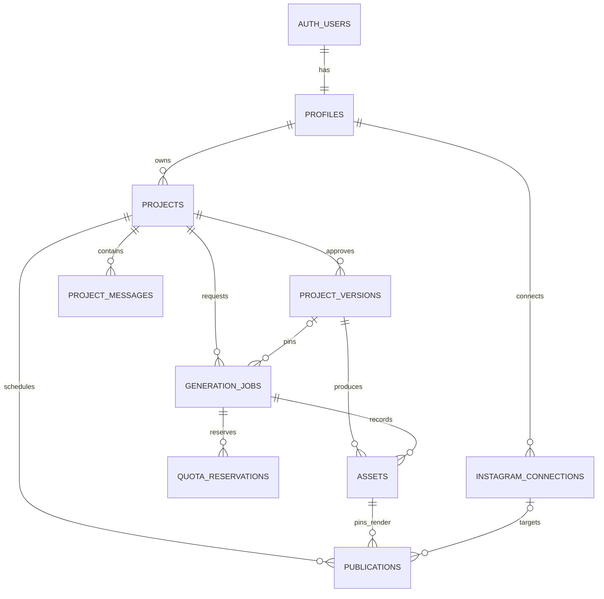

# Database, authorization, and storage specification

**Status:** Logical implementation contract, 19 October 2026. No migrations or policies have been applied. [PRD](PRD.md) owns limits/scope; [API/workflows](API_WORKFLOWS.md) owns state transitions.

Cross-component behavior and deployment boundaries: [detailed system design](SYSTEM_DESIGN.md).

## 1. Modeling rules

Supabase Postgres owns metadata and state. Supabase Storage owns binary media. Use UUID primary keys, `timestamptz` instants, explicit foreign keys, and validated bounded JSONB for scene/timing specifications. Do not create a table per caption word, a generalized event-sourcing system, or MongoDB beside Postgres.

Store schema version with every structured plan/timeline. Drafts are mutable with optimistic revision checks; approved version content is immutable. Separate review/publication records from content so marking an output reviewed does not mutate the approved narration plan.

## 2. Tables

| Table | Minimum fields | Constraints/relationships |
|---|---|---|
| `profiles` | `id`, `approved`, `preferred_timezone`, timestamps | `id` references auth user; approval defaults false and is never client-editable |
| `projects` | `id`, `owner_id`, `title`, `brief` JSONB, `draft_plan` JSONB nullable, `draft_revision`, `approved_version_id` nullable, `last_stage`, `deletion_requested_at`, timestamps | Owner required; revision nonnegative; approval pointer must belong to same project |
| `project_versions` | `id`, `project_id`, `owner_id`, `version_number`, `schema_version`, `content` JSONB, `content_hash`, `approved_at`, timestamps | Unique project/version number; approved content immutable; composite ownership consistency enforced |
| `project_messages` | `id`, `project_id`, `owner_id`, `role`, `stage`, `text`, `revision`, `created_at` | Bounded history/text; allowed roles user/assistant/system-summary; no tokens |
| `generation_jobs` | `id`, `project_id`, `owner_id`, `version_id` nullable for planning, `kind`, `state`, `stage`, `target_format`, `operation_scope`, `idempotency_key`, `request_hash`, `revision`, `attempt`, `live_claim_held`, `cleanup_state`, `provider_refs` JSONB, `heartbeat_at`, `error_code`, `cancel_requested_at`, timestamps | Unique owner/operation-scope/idempotency key; explicit version for production; compatible project/version foreign keys; job revision separate from attempt |
| `assets` | `id`, `owner_id`, `project_id`, `version_id`, `job_id`, `scene_id` nullable, `kind`, `format`, `storage_path`, `content_hash`, `dependency_key`, `metadata` JSONB, `reviewed_at`, `availability`, timestamps | Unique storage path; `kind` includes audio/alignment/timeline/render/poster; review only completed render assets |
| `publications` | `id`, `owner_id`, `project_id`, `render_asset_id`, `connection_id` nullable, `mode`, `post_caption`, `destination_snapshot` JSONB, `scheduled_at`, `timezone`, `revision`, `state`, `idempotency_key`, `request_hash`, `external_refs` JSONB, `error_code`, timestamps | Mode live/simulated fixed per job; pinned reviewed artifact; one active publication per project initially; submission idempotency scoped by owner/project |
| `instagram_connections` | `id`, `owner_id`, external account ID/label, encrypted token fields, expiry, `health`, timestamps | Conditional live integration only; one selected connection per user; no raw token client reads |
| `quota_reservations` | `id`, `job_id`, `attempt`, `provider`, `window_key`, `reserved_units`, `observed_units`, `state`, timestamps | Internal only; nonnegative units; distinguish provider units; unique job/provider/attempt reservation identity |

Fields may be renamed consistently in code/migrations. Do not introduce all optional live-Instagram tables before that milestone. Public samples initially use explicitly curated fixtures and designated public media, not a broad policy exception on private tables.

### Logical relationships



This is a logical ER diagram, not a migration. All owned children retain matching owner/project constraints; nullable relationships account for planning-only jobs and simulated publication. `projects.approved_version_id` is a selected-version pointer, not permission to attach another project's version. Compatible source assets can be referenced from a later composition without changing their original version/lineage.

## 3. Ownership and RLS matrix

| Data | Browser access | Server/background access |
|---|---|---|
| Profile | Read own safe fields; update own time zone only | Approval only through trusted owner administration |
| Projects/drafts/messages | Read own undeleted records; mutations through validated app routes | Session-scoped access preferred; verify owner before privileged work |
| Approved versions | Read own; no direct content writes | Insert on valid approval transaction; no content mutation |
| Jobs/assets/publications | Read own safe projection; no direct authoritative status/review writes | Validated handlers control transitions and review |
| Quota data | None | Trusted server only |
| Connection secrets | None | Trusted server only; expose separate safe account projection |

Enable RLS and default deny. An authenticated Supabase role alone is insufficient for live actions: server checks `approved` immediately before external spending/render submission. A profile cannot update itself to approved through unrestricted UPDATE grants/policies. Use column grants or protected RPC/trigger enforcement, not merely a UI restriction.

Use `owner_id = auth.uid()` for permitted user reads and validate parent ownership for children. A forged child with another project's ID must fail even if its owner_id matches the attacker. Enforce parent/child owner and version consistency in the database, using composite constraints or a narrow trusted transaction with supporting constraints. Service-role bypass requires explicit application authorization; RLS is not a substitute for it.

For unauthorized resource identifiers, return the generic missing/unavailable result without exposing existence or provider references. Tests must use two ordinary users, an unapproved user, and a privileged background path.

## 4. Transactions and race safety

### Autosave

Update only where project owner, undeleted state, and expected `draft_revision` match. Increment revision atomically and return it. Zero updated rows means missing/conflict, not Saved. Do not append messages or duplicate versions on every keystroke.

### Approve and start

In one transaction: lock/validate current project revision; create immutable approved version; create idempotent job; reserve configured quota; update approval pointer. Do not start a provider call inside a database transaction. Dispatch after commit; persistence success with event failure becomes `dispatch_pending`.

### Concurrency and quota

Use one narrow transaction/RPC with an advisory transaction lock for quota reservation and global live-job claim. Enforce the initial one-active-generation limit with an appropriate uniqueness/claim constraint, not an in-memory flag on a Vercel instance. Reservations include retry attempts and ambiguous outcomes conservatively. Application budgets are configured below account quotas; values are not subscription credits.

`live_claim_held` defaults false. A partial unique index on a constant for rows with this flag true enforces at most one global live production claim, independently of job success state. `cleanup_state` tracks not-needed/pending/confirmed/needs-attention without corrupting content success. Keep the claim while sandbox shutdown is unresolved, even if a validated stored output is succeeded; release only after provider reconciliation confirms no old active renderer.

No Redis lock service is necessary. If a job has an expired heartbeat, do not automatically free its claim and start another render: reconcile provider state first. An uncertain live sandbox can still consume resources. Mark needs attention and keep the claim until stopped/reconciled or deliberately recovered.

### Completion/review

Only mark a render ready after private storage persistence and required validation. Review identifies a specific available render asset, not all outputs of a version. Publication creation locks/checks that reviewed artifact. A stale callback cannot move succeeded/published backward to rendering/failed.

### Schedule changes

Lock publication, require expected revision, update pinned values/state, increment revision. A wake event includes the old revision and exits if it no longer matches. Pin referenced assets against cleanup. Details: API/workflows guide.

## 5. Indexes

Start with indexes for owned project lists ordered by update time; project/version uniqueness; job owner/idempotency lookup; active jobs/state; assets by project/version/dependency key; publication due/state lookup; and reservations by provider/window. Add indexes from actual queries, not speculative scale targets. Foreign keys with frequent cleanup/lookups need supporting indexes as appropriate.

## 6. Storage paths and policies

Use a private bucket for creator media. Example path structure:

```text
<owner-id>/<project-id>/<version-id>/<job-id>/<artifact-id>.<extension>
```

Paths are server constructed with validated identifiers and approved extensions. A storage path is not proof of ownership: authorize the referenced asset and project before signing access. Never let a client supply arbitrary paths to sign, overwrite, or delete.

Prefer server/worker writes and authenticated signed reads. Select path-specific signed upload authorization for sandbox output, minted by trusted orchestration immediately before upload. Do not place a broad Supabase service key in the sandbox, render props, public bundle, or workflow event. Verify the actual token lifetime/protocol rather than assuming a configurable TTL. Validate actual file bytes/type/size/duration rather than trusting extension or client metadata. Details and refresh/reconciliation rules: system design section 10.

Public sample media is an explicit curated set with permitted rights. User media never becomes public merely because a sample slug resembles its ID. Final upload goes directly from the sandbox to Storage, avoiding function body limits. Persist paths; generate signed URLs only at access time. An expired URL does not invalidate the asset.

## 7. Retention and deletion

Use PRD section 18 for retention/size policy. References from active jobs, reviewed selected outputs, schedules, or curated samples pin artifacts. Cleanup first computes references and offers a dry-run list/byte estimate, then removes only permitted owner/project paths. Missing objects are safe on repeated cleanup; failures are recorded without declaring full success.

Project delete marks it inaccessible and cancels/blocks pending work. Do not hard-cascade-delete a job/connection needed to reconcile an in-flight external action. After work is terminal/reconciled, clean private files and dependent metadata. Retain only minimal safe operational evidence if needed for unresolved publication status. Deleting a project does not delete a real Instagram post.

## 8. Migration and evidence requirements

Implement schema and RLS in versioned migrations, with deterministic seed fixtures excluding secrets. Test migrations on disposable/local data before applying to hosted data. No ad hoc destructive reset against a real project. Add test evidence for cross-owner denial, self-approval denial, immutable versions, autosave conflicts, global claim race, idempotency uniqueness, and pinned-asset cleanup. Schema design here is not evidence that any policy currently exists.

## T03 implementation status

The first migration implements profiles, projects and immutable versions plus a closed private bucket. Remaining tables are planned. See [auth setup](SUPABASE_AUTH_SETUP.md) and [progress](PROGRESS.md) for local SQL evidence and hosted verification gaps. No hosted migration has been applied.
