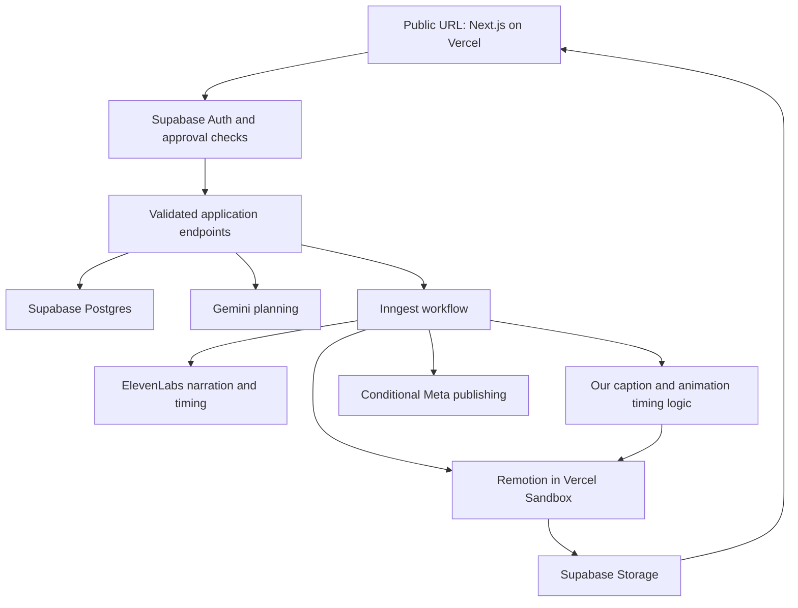

# Product Requirements Document — AI Educational Explainer Studio

**Version:** 1.0 — final planning baseline  
**Date:** 19 October 2026  
**Purpose:** Portfolio/resume application  
**Budget:** $0 for APIs, hosting, storage, infrastructure, and subscriptions  
**Delivery:** Public web application with quota-limited hosted generation  
**Implementation status:** T01 scaffold and T02 shared schemas/sample data implemented; provider integrations and verification pending. See [progress](PROGRESS.md).  
**Product name:** IdeaMotion — user-approved name. Visual direction: Violet & Peach; see UI/UX specification and Stitch design reference.

**Implementation guides:** See the [documentation index](README.md) for UI/UX, database, API/workflow, video timing, testing, deployment, and ordered task contracts. These expand this PRD without changing its scope.

## 1. Authority, scope, and reading guide

This PRD consolidates the product discussion, the [BRD](BRD.md), [portfolio constraints](PROJECT_CONSTRAINTS.md), and [selected architecture](ARCHITECTURE.md). It is the implementation baseline. If older documents conflict with this PRD, the latest user instruction takes priority, followed by this PRD. Earlier local-only hosting recommendations are superseded.

The confirmed scope is an educational motion-graphics video generator with a simple **Idea → Plan → Video → Publish/download** workflow. It uses Gemini, ElevenLabs timing, our own caption/animation synchronization logic, Remotion, Vercel Sandbox, Supabase, and Inngest. It must be showcaseable through a public URL without the developer's computer running.

Specific numerical defaults, route names, data structures, and implementation choices in this document are planning defaults selected to make development actionable. They are not assertions of separate stakeholder approval or provider guarantees. They may be adjusted when benchmarks reveal a real constraint, provided the $0 budget, agreed scope, public-demo objective, and honest behavior are preserved. Changes to those core constraints require a new product decision.

External provider access, licenses, actual account quotas, and end-to-end rendering feasibility remain verification gates. A final PRD is not a claim that those gates have already passed.

## 2. Product summary

An approved creator describes a topic or brainstorms with AI. The application generates a combined script and storyboard. After approval, it generates AI narration and renders a 60–90 second motion-graphics explainer with captions timed to the spoken content. The creator reviews or revises the video, downloads it, and can use an Instagram publishing workflow where access is available.

Videos support **vertical 9:16** and **horizontal 16:9**, with layouts composed for each format. Motion graphics should explain concepts through diagrams, labels, arrows, comparisons, processes, and animated text. V1 is not a cinematic footage generator or avatar platform.

The product demonstrates good full-stack development: a responsive interface, authentication and authorization, structured AI integration, programmatic media, asynchronous workflows, data persistence, secure storage, meaningful tests, and realistic handling of external limits. Paying customers, enterprise uptime, and commercial traction are not its purpose.

## 3. Objectives and definition of success

| ID | Objective | Evidence at completion |
|---|---|---|
| OBJ-01 | Give a reviewer a usable public application | Working Vercel URL, sample projects, responsive screens, clear demo restrictions |
| OBJ-02 | Demonstrate real hosted video generation | Approved-user flow using real providers, hosted render, stored output, and download within verified free quotas |
| OBJ-03 | Make an explanation visually understandable | Three benchmark topics reviewed for accuracy, clarity, and narration/visual agreement |
| OBJ-04 | Demonstrate synchronization | Captions and explanatory events follow actual ElevenLabs timing in both formats |
| OBJ-05 | Demonstrate maintainable engineering | One modular codebase, typed validation, ownership policies, focused tests, documented setup and tradeoffs |
| OBJ-06 | Avoid expenditure | Free plans only, bounded usage, no automatic upgrade/top-up or paid fallback |

Success does not require unlimited anonymous generation, guaranteed scheduled posting, support staff, a payment system, or a production-scale architecture.

## 4. Users and access modes

| Mode | Intended user | Allowed behavior |
|---|---|---|
| Public sample mode | Recruiter or portfolio reviewer | Explore explicitly curated sample projects, preview prepared videos, inspect storyboard/caption examples, download only designated sample outputs |
| Signed-in, not approved | Visitor who authenticates | View access status and samples; no live provider calls, rendering, private project access, or publishing |
| Approved creator | Owner or explicitly approved tester | Create private projects, use live AI within shared free budgets, revise, render, export, and use available publishing integration |

Use Supabase Auth. The user's expanded Stitch design request includes email/password sign-in, signup, email verification, forgotten-password and reset-password screens. This supersedes GitHub-only OAuth as the intended UI. Before implementation, verify a realistic $0 email-delivery path, provider restrictions and reset/confirmation redirect configuration; these mockups do not establish delivery feasibility. Do not add paid SMTP or promise unrestricted email delivery. Supabase and server-controlled approval remain unchanged.

Approval is a server-controlled boolean/allowlist record. A user cannot grant themselves approval through signup metadata, a client request, a profile update, or a token field they can edit. This is not a team management feature: no custom roles UI, invitations product, or enterprise hierarchy is needed. Owner approval can be managed through trusted Supabase administration.

Public samples must be deliberately published as samples; never expose a private project by merely omitting a user filter. Sample interactions that use fixtures are labeled **Sample mode** or **Simulated**. A simulated action never displays a real publishing-success claim.

## 5. Scope and priorities

### 5.1 Required core

| ID | Capability | Resume purpose |
|---|---|---|
| CAP-01 | Responsive dashboard, authentication, private project ownership | Modern UI, full-stack identity and authorization |
| CAP-02 | Conversational idea planning | AI interaction and structured input handling |
| CAP-03 | Combined script/storyboard with approval | Editable generated data and workflow design |
| CAP-04 | Educational motion graphics | Reusable animation composition and visual reasoning |
| CAP-05 | ElevenLabs narration plus timing | External API integration and audio processing |
| CAP-06 | Custom captions and animation synchronization | Deterministic timing logic and data transformation |
| CAP-07 | Conversational revisions | Change classification and dependent artifact invalidation |
| CAP-08 | Both aspect ratios, preview, 1080p MP4 export | Responsive composition and media delivery |
| CAP-09 | Autosave, job status, bounded recovery | Persistence and asynchronous state handling |
| CAP-10 | Public hosted app and limited real hosted rendering | Deployment and cloud execution within constraints |
| CAP-11 | Inngest orchestration and saved scheduling workflow | Durable steps, dates/times, cancellation, idempotency |
| CAP-12 | Clearly labeled sample fallbacks and quota guards | Honest graceful degradation and safe public demonstration |

### 5.2 Included interface; conditional live integration

Instagram connection, editable post caption, publish-now/schedule controls, and publishing states belong to the product workflow. Actual Meta connection and publication are conditional on eligible accounts, permissions, provider access, and a verified $0 integration. A labeled simulated publishing adapter is acceptable for the portfolio release when live access is unavailable. The README and UI must state which adapter is active.

Do not claim that live Instagram works based on simulated tests. Do not let a delayed Meta approval block the core video product or trigger paid infrastructure purchases.

### 5.3 Excluded

Billing, subscriptions, credit wallets, customer usage dashboards, branding kits, custom logos/fonts, teams, agencies, enterprise roles, avatars, voice cloning, lip sync, photorealistic generation, professional timeline/keyframe editing, long-form video, bulk generation, other social platforms, social analytics, music generation/library integration, PDF/PPT/webpage imports, and fully unattended recurring content creation.

Use a coherent internal visual style without exposing branding settings. Narration is sufficient audio for V1. No MongoDB, Better Auth, Cloudflare R2, GCS, Redis, Kubernetes, cloud GPU service, or additional queue infrastructure is included.

## 6. Selected tools and architecture

| Layer | Tool | Responsibilities |
|---|---|---|
| App and endpoints | Next.js, TypeScript, Node.js runtime | UI, protected APIs, validation, provider coordination |
| Auth | Supabase Auth Free | Identity and sessions |
| Database | Supabase Postgres Free | User approval, projects, versions, jobs, assets, schedules |
| Media storage | Supabase Storage Free | Private audio/video/assets, signed playback/download |
| Public hosting | Vercel Hobby | Portfolio URL and short-running application endpoints |
| Workflow | Inngest Free | Durable steps, retries, waits, render checks, scheduling |
| Animation/render | Remotion + Vercel Sandbox Hobby | Custom graphics and hosted MP4 export |
| Planning AI | Eligible Gemini API free-tier model | Ideas, scripts, storyboard, revision proposals |
| Narration | ElevenLabs Free timing-enabled TTS | Audio and character-level alignment |
| Synchronization | Our TypeScript modules | Captions, phrase anchors, scene/global timing |
| Validation | Shared runtime schemas; Zod is the default candidate | Validate client input, AI output, database boundaries |
| Tests | Vitest + a small Playwright suite as defaults | Unit/integration and core browser flows |

Keep one repository and one modular application. Inngest handlers execute in the deployed application environment; Inngest coordinates rather than providing our render machine. Heavy rendering runs in Vercel Sandbox, not in an ordinary route handler or a long blocking Inngest step.



The public application must not need the developer's computer online. Local setup remains a supported development and export fallback.

## 7. Navigation and common screen behavior

Primary navigation: **Projects**, **Create video**, **Settings**. Publishing and schedules are available through the project and dashboard filters; no separate social management suite is needed.

Suggested routes:

| Route | Purpose |
|---|---|
| `/` | Portfolio product introduction, Explore sample, Sign in |
| `/samples` | Curated public examples |
| `/samples/[slug]` | Read-only/sample-backed workflow |
| `/projects` | Signed-in private project dashboard |
| `/projects/new` | Create the project brief |
| `/projects/[id]` | Four-stage workspace with persistent stage selection |
| `/settings` | Session/account status and Instagram connection |

Use one project workspace rather than four disconnected forms. Persist the selected stage, but derive available actions from saved artifact states. A user can revisit earlier stages without losing work.

Required common states: initial loading, empty state, saving, saved, unsaved/network error, blocked by quota, unauthorized, not found, in-progress job, recoverable failure, and completed output. A spinner must not replace actionable status indefinitely. Do not show invented progress percentages or guaranteed completion times.

Desktop supports a side-by-side conversation/content layout. Narrow screens stack content and retain accessible primary actions without obscuring captions or playback controls. All actions must be keyboard accessible, visibly focused, and labeled; errors must be text, not color alone.

## 8. Dashboard and project lifecycle

Dashboard cards show title, format, latest update, meaningful creation state, and resume action. Show pending/publication state separately: a project may have a ready version, a newer draft, and a pinned schedule simultaneously.

Required actions: create, resume, rename, and delete a project with a reviewable confirmation. No folders/tags/team management is required. Deleting a project must first address its pending schedule and active job; it must not silently orphan a live publication task.

Empty state contains one Create video action and access to samples. Failed jobs display a short reason and Resume/retry where appropriate. Selecting a running project reconnects to the saved job rather than starting another.

**Planning limits:** maximum ten active projects per approved user and one active generation/render across the initial demo. These are safeguards, not subscription limits. If a limit is reached, offer to remove an old project or wait; do not sell an upgrade.

## 9. Stage 1 — Idea

### 9.1 Main interaction

The creator enters a topic, explanation, or request for ideas. AI can brainstorm in the same conversation. Optional compact settings sit beside/below the topic; no mandatory onboarding questionnaire or separate prompt wizard.

| Field | Default | Validation/behavior |
|---|---|---|
| Topic/brief | Empty | Required before plan generation; 10–2,000 characters after trimming |
| Audience | Beginners | Optional; max 200 characters |
| Learning objective | AI-inferred | Editable; max 300 characters |
| Tone | Clear and friendly | Small predefined set; no extensive style controls |
| Language | English | Only benchmarked English voices in V1; no implied multilingual support |
| Format | Vertical 9:16 | Vertical or horizontal |
| Length | Automatic 60–90 seconds | Optional integer target from 60 through 90; no required preset selection |
| Reference notes | None | Optional pasted text, max 5,000 characters; no URL fetching/file ingestion |
| Voice | One tested standard voice | Small server-approved list; availability checked before synthesis |

Limits are application defaults to tune downward if needed to protect free quotas. Validate both client-side for usability and server-side for enforcement.

### 9.2 Behavior

- A sufficiently specific topic proceeds directly. Ask clarification only if the ambiguity materially changes the explanation.
- A broad request returns a small number of concrete options, not a long interrogation.
- A topic too large for 90 seconds is narrowed or split conceptually; V1 does not secretly produce a long-form video.
- Reference notes are source content, never executable instructions or authority to bypass validation.
- AI may propose an angle but must not invent numerical evidence or claim guaranteed factual correctness.
- Primary action: **Create plan**. While pending, repeated clicks refer to the same request.
- Persist chat/brief changes; quota failure preserves input and offers sample mode or retry after allowance reset.

## 10. Stage 2 — Combined script and storyboard

Show an ordered set of scene cards containing narration, on-screen text, representative visual layout, animation description, and estimated duration. No separate script stage or duplicate script approval screen.

Represent the hook, explanation, helpful example, and takeaway without forcing every topic into identical scene counts. Initial component validation may permit 4–10 scenes; choose count based on explanation and pacing, not a mandatory user setting.

Visual previews are generated from supported component layouts or clear placeholders. They establish direction and are labeled representative; estimated duration is not claimed to be measured audio timing.

Creator actions:

- Edit narration or on-screen text in a scene.
- Ask AI to revise a scene or the whole plan, such as “simplify scene 2” or “use a daily-life example.”
- Review updated cards and a concise description of changed scenes.
- Choose **Approve & generate video** to approve a specific saved plan version and start production.

No full media generation occurs before this approval. Approval is immutable for that version. Editing underlying content creates a new draft and invalidates its approval without deleting the old version.

AI output must match a validated scene schema and select supported visual components. Unsupported output gets one bounded repair attempt before an actionable error. Narration and asset constraints are checked before spending voice/render allowance.

## 11. Stage 3 — Video, revisions, and export

### 11.1 Generation display

Show actual saved stage: Queued → Preparing scenes → Creating voiceover → Synchronizing → Rendering → Checking video → Ready. Display completed stages and a concise current action rather than synthetic percentage completion.

Refreshing or closing the browser does not stop the hosted job. Jobs persist in Supabase and continue through the hosted workflow while services are available. Provider quota exhaustion or service pause may stop progress; show the limitation honestly.

Creator can request cancellation. Pending work should stop; in-flight provider work may finish and consume allowance. Show **Cancel requested** until the application confirms cancellation or completion.

### 11.2 Finished preview

Provide playback, pause, seek, volume, format/duration labels, captions, and a revision input. The preview must correspond to the exact exported version. Prefer the rendered artifact as the final review surface; any interactive Remotion preview must use matching composition/version settings.

Do not autoplay/preload full MP4s on dashboard cards. Use poster images and user-initiated loading to conserve egress. Expired signed media access can be refreshed without re-rendering.

### 11.3 Conversational revision rules

| Request | Reuse | Rebuild/review |
|---|---|---|
| Change visual emphasis, color contrast, label position | Compatible narration/alignment | Affected graphics and render; review new output |
| Correct caption spelling without changing spoken meaning | Audio and valid word timing | Caption display and render |
| Change spoken sentence or voice | Compatible unaffected scenes | Affected audio, alignment, captions, cues, render |
| Slow one scene | Compatible content where possible | Retiming and possibly new speech; validate full duration |
| Change topic/learning objective or major structure | Prior output remains available | Return revised combined plan for approval |
| Change format | Script and compatible audio | Recompose layout and render; review alternate output |

If interpretation is ambiguous, ask a concise clarification. A revision must not silently change unrelated scenes. Preserve the latest completed output while a replacement runs. No timeline, keyframe editor, or manual audio cutting is required.

### 11.4 Export specification

- MP4 with H.264-compatible video and AAC audio as the initial compatibility target, subject to the benchmarked encoder configuration.
- Vertical: 1080 × 1920. Horizontal: 1920 × 1080.
- Planning default: 30 fps, burned-in captions, English narration.
- Final runtime 60–90 seconds, including transitions/holds; optional target is a pacing target, not a reason to clip speech.
- Render the chosen format first. Requesting the alternate format reuses compatible content/audio but generates a separate reviewed output.
- Text, diagrams, and captions must be recomposed for the aspect ratio, never stretched or blindly cropped.
- Bitrate must be benchmarked against Supabase's free per-file limit and legibility. A 90-second result is not automatically small enough because it is short.
- Reject an oversized artifact before upload and offer an approved encoding retry or local export fallback. Do not silently reduce the promised dimensions or purchase storage.

Primary progression action: **Ready to publish**. Download can also be accessible from a ready preview; do not force Instagram connection to obtain an MP4.

## 12. Stage 4 — Download and Instagram workflow

### 12.1 Common surface

Show the exact reviewed video version, format, destination, editable suggested post caption, and three clear outcomes: Download, Publish now, Schedule. Content captions burned into video are distinct from the Instagram post caption.

When live Instagram is unavailable, show **Simulated publishing — no post will be sent** before the action and in its result. A simulation may demonstrate saved states without contacting Meta.

### 12.2 Live connection, conditional on access

- One eligible professional Instagram account per creator.
- Authorized Meta connection flow with anti-forgery state, server-side callback validation, and secured tokens.
- Display destination identity and connected/expired/revoked/disconnected state.
- Denied consent, invalid callback, ineligible account, and expired access do not remove video/download access.
- Disconnect disables pending submissions and marks schedules needs attention.
- Reconnecting to a different identity requires explicit destination review before resuming any schedule.
- Recheck actual Meta login route, scopes, review requirements, media specifications, and delivery requirements during integration. Do not infer them from an old SDK example.

### 12.3 Publishing policy

Initial product policy: Instagram publication uses a reviewed vertical version. Horizontal downloads remain fully supported. Offer a vertical adaptation and review; do not silently crop a horizontal video. This is our V1 simplification, not a universal platform restriction claim.

Require valid connection, authorized project ownership, reviewed artifact, supported media, and explicit action. Upload accepted/processing is not equal to published. Save the external media/post identifier and confirm status before reporting success.

If a publish request times out after possible provider acceptance, mark outcome unknown and reconcile before retrying. Do not blindly submit again. A deliberate repeat post requires another explicit action.

### 12.4 Scheduling behavior

- Save instant in UTC and retain/display the creator's selected IANA time zone.
- Planning window: at least two minutes in the future and no more than seven days ahead.
- Show local date/time, zone, and offset before confirmation; handle daylight-saving ambiguity explicitly.
- Pin artifact version, destination account, and post caption. Project edits do not silently replace a schedule.
- Inngest waits or dispatches within its free limits; re-read saved schedule state immediately before submission.
- Cancel/reschedule pending jobs by updating the saved schedule/revision. Waking old workflow runs must exit when their revision is stale.
- Once external submission begins, cancellation is best-effort; show actual final state.
- Retry temporary failures within a proposed 15-minute late-publication window. After that, require user review instead of surprising late posting.
- A free-service outage, paused database, or quota exhaustion can prevent dispatch. No guaranteed publishing SLA or email/push alert service is included. Use in-app needs-attention status.

Actual scheduling can be demonstrated using a simulated publishing adapter when Meta access is unavailable. Clearly separate this from successful external publication.

## 13. Narration, captions, and motion pipeline

### 13.1 Structured plan

Each scene needs a stable ID, narration text, display text, supported component type, entities/relationships, animation intent, estimated duration, and phrase anchors. A phrase anchor identifies both a phrase and its occurrence in that scene; matching the first repeated word in the entire script is invalid.

Use a small, tested library: title/concept card, labeled diagram, process/steps, comparison, simple supported-data chart, takeaway, emphasis/highlight. AI selects and parametrizes these elements; it does not execute arbitrary generated JavaScript or HTML.

If a concept requires unsupported visuals, propose a simpler supported explanation before synthesis. Do not hallucinate a renderable asset or invent chart data.

### 13.2 ElevenLabs speech and alignment

Use a timing-enabled ElevenLabs endpoint/model combination verified with the selected free account. Do not assume every voice/model combination returns equivalent timing.

Planning default: scene-level synthesis to support targeted revision and reuse. Benchmark voice continuity and sentence boundaries. If it creates unnatural joins, adjust synthesis segmentation while keeping version dependencies explicit.

For each segment:

1. Validate audio decodability and its measured duration.
2. Validate alignment field lengths, finite timestamps, monotonic ordering, and bounds.
3. Select alignment corresponding to actual spoken/normalized content.
4. Reconcile spoken numbers, abbreviations, symbols, punctuation, and proper nouns with intended display text.
5. Group character timings into words and readable phrases.
6. Map validated phrase occurrences to animation cues.
7. Calculate local scene timeline, then global offsets including holds/transitions.

No Whisper, WhisperX, separate transcription API, or forced-alignment provider is included. Invalid timing triggers bounded repair/re-synthesis or a recoverable failure, never fake evenly spaced word timing presented as synchronized speech.

### 13.3 Caption composition

- Phrase-based burned-in captions, maximum two lines initially.
- Target short phrases; initial limit of approximately 32 characters per line, adjusted by measured width rather than character count alone.
- Prefer readable holds around 0.8–3 seconds; avoid flashing fragments while never allowing timing to contradict speech.
- Use high contrast and tested safe regions. Reflow diagrams away from captions; essential labels cannot be covered.
- Blank captions during meaningful silence rather than leaving stale text visible.
- Correct display text can retain audio timing; a spoken-meaning change requires narration revision.
- Caption edits must preserve semantic correspondence or explicitly request speech regeneration.

### 13.4 Animation cues

Separate the cue's spoken anchor from its visual event duration. A highlight can start at the phrase, while an arrow continues moving or a diagram remains visible. Avoid simultaneous visual changes that make the explanation unreadable.

If an anchor cannot be resolved, repair the affected scene or fail it clearly. Do not silently guess timestamps. Keep all events within their scene or explicitly declared transition interval. Reuse global narration offsets consistently across visual and caption timelines.

### 13.5 Runtime adjustment and output checks

Estimate length at planning time; enforce actual runtime after speech generation. Do not cut off narration, add excessive silence, or accelerate speech unnaturally to meet the target. Material script changes return for approval.

Before Ready, check compatible versions, nonempty scenes, audio/video decodability, expected dimensions, duration, timing bounds, complete ending, required assets, and layout overflow. Automated checks are necessary but do not establish factual correctness; creator review and benchmark evaluation remain required.

## 14. Hosted execution and recovery design

1. Protected endpoint validates identity, ownership, approved plan version, request size, idempotency key, and available budget.
2. Database transaction creates/reserves one logical job and any quota reservation. Event contains IDs, not full media or confidential script payloads.
3. Dispatch Inngest event. If dispatch fails after persistence, mark dispatch pending and allow an explicit resume/reconciliation path. Do not lose the saved job or create a duplicate.
4. Durable short steps generate/check scene artifacts and store their references.
5. Start a Vercel Sandbox render; record sandbox identity and attempt before dependent work.
6. Wait/check progress using bounded intervals and a maximum job deadline. Do not repeatedly poll in a tight loop.
7. Sandbox uploads the final file directly to the authorized Supabase destination. Do not send an MP4 through an ordinary API response or an Inngest event.
8. Validate stored artifact metadata and mark the render ready atomically enough to avoid a Ready state with no playable output.
9. Stop sandbox and clean intermediates where safe.

Inngest orchestration does not extend a Vercel route's maximum execution time. Any synthesis/asset request must fit the configured function runtime or be segmented/adapted. Sandbox filesystem is temporary; ephemeral completion without successful persistence is not a completed hosted export.

Use a database uniqueness rule and atomic claim for the initial single active render. Store job attempt IDs and provider references. “Exactly once” external side effects are not assumed: retries may occur and must reconcile known outcomes. When a timeout leaves sandbox creation or publishing ambiguous, check saved/provider status before starting another operation. If status cannot be determined, require attention rather than spending repeatedly.

Planning default: at most two retries for transient provider/network faults, with backoff; zero blind retries for invalid input, authorization, quota exhaustion, or uncertain publication. Successful compatible scene artifacts survive retries. Count attempts and reservations conservatively against the free allowance even when a provider response is lost.

## 15. Data model and ownership

Use relational ownership/job fields with validated JSONB for structured scene plans and timing payloads. Do not over-normalize every word or animation into separate tables.

| Logical table | Minimum information |
|---|---|
| `profiles` | Supabase user ID, approval flag, preferred time zone, timestamps |
| `projects` | ID, owner ID, title, brief/settings, draft revision, latest approved version ID, timestamps |
| `project_versions` | ID, project ID, revision number, immutable approved plan/settings, scene IDs/content, review state, creation/approval time |
| `project_messages` | Project ID, author/type, bounded text, stage, associated revision; optional if a compact bounded JSON history is simpler |
| `generation_jobs` | Project/version IDs, job type, state/stage, attempt, idempotency key, error code, provider/sandbox references, last progress, timestamps |
| `assets` | Owner/project/version IDs, scene ID if applicable, kind, format, private storage path, hash, dimensions/duration/bytes, compatibility metadata |
| `publications` | Owner/project/render IDs, adapter mode, destination connection ID, caption, UTC due instant, zone, schedule revision, state, external IDs |
| `instagram_connections` | Owner ID, external identity, encrypted tokens, expiry/health; required only for live adapter |
| `quota_reservations` | Job/user/provider, reserved/observed units, window, state; minimal internal guard, not billing |

Use UUIDs, foreign keys where appropriate, created/updated timestamps, and uniqueness on idempotency/version identities. Precise SQL/migrations are implementation artifacts, not a separate architecture project.

Use stable owner/project/version/scene identities in media paths. Store the private path, not an expiring signed URL, as the durable reference. Keep raw alignment in bounded JSON or a private JSON artifact based on measured size. Never store full MP4/audio base64 in database rows.

Apply RLS to user-owned records and storage policies. Owner ID is derived from session or persisted authorized job, not accepted as trusted client input. Server privileged access requires an explicit ownership check before bypassing RLS. A public sample is a separate curated asset/view, not an exception that exposes all projects.

## 16. Versioning, autosave, and states

### 16.1 Version dependency rules

- Approve a saved immutable plan version; generation pins that version.
- A ready render references compatible narration, alignment, captions, visual plan, and format.
- Narration changes invalidate dependent timings/captions/cues; visual-only edits preserve compatible audio.
- New drafts never mutate an artifact that a pending publication references.
- Alternate formats have distinct renders and review flags, even if content/audio is shared.
- Preserve latest completed output while generating its replacement.
- Multi-tab writes include expected revision; stale updates return a conflict rather than silently overwriting.
- A published post always references the submitted immutable render. Project edits never implicitly edit/delete the Instagram post.

### 16.2 Autosave

Debounce edits approximately 1 second and aim to persist within 2 seconds after a pause under normal connectivity. Display Saving/Saved/Unsaved. Save before approval or navigation that would discard unsaved edits. Retry network failures without resetting form input. Preserve non-sensitive draft text locally when feasible; never cache provider secrets or Instagram tokens in browser storage.

### 16.3 State definitions

| Object | States |
|---|---|
| Plan | Draft, approved, superseded |
| Generation | Dispatch pending, queued, preparing, synthesizing, synchronizing, rendering, validating, succeeded, failed, cancel requested, canceled, needs attention |
| Render | Ready for review, reviewed, superseded, unavailable |
| Publication | Draft, scheduled, submitting, processing, published, failed, needs attention, outcome unknown, cancel requested, canceled |
| Connection | Connected, expired, revoked, disconnected, needs attention |

Prevent late duplicate callbacks from regressing a terminal success. A project status is a summary of these objects, not one overloaded field representing everything.

## 17. Application API surface

These are proposed internal routes. Each mutation validates session, approval where needed, ownership, body schema, expected revision, and idempotency before external work. Return identifiers/status and poll/read endpoints rather than holding requests open until video completion.

| Endpoint | Purpose |
|---|---|
| `GET/POST /api/projects` | List/create owned projects |
| `GET/PATCH/DELETE /api/projects/:id` | Resume, autosave/rename, delete |
| `POST /api/projects/:id/ideas` | Bounded planning conversation |
| `POST /api/projects/:id/plan` | Generate/revise combined plan |
| `POST /api/projects/:id/approve` | Approve saved version and enqueue one production job |
| `POST /api/projects/:id/revisions` | Classify scoped change and create draft/job |
| `POST /api/projects/:id/renders` | Render selected compatible version/format |
| `GET /api/jobs/:id` | Owned job status and recovery action |
| `POST /api/jobs/:id/retry` | Bounded valid recovery |
| `POST /api/jobs/:id/cancel` | Request cancellation |
| `GET /api/assets/:id/access` | Authorized signed preview/download access |
| `POST/PATCH/DELETE /api/projects/:id/publication` | Publish/schedule/reschedule/cancel intended job |
| `GET /api/instagram/connect` and callback | Conditional live connection flow |
| `DELETE /api/instagram/connection` | Disconnect and block affected pending submissions |
| `/api/inngest` | Verified Inngest handler; no public arbitrary job execution |

Use a consistent error shape containing a stable code, safe message, retryable flag, and job/request ID. Example codes: `VALIDATION_ERROR`, `NOT_APPROVED`, `VERSION_CONFLICT`, `FREE_QUOTA_EXHAUSTED`, `ALIGNMENT_INVALID`, `RENDER_FAILED`, `ASSET_TOO_LARGE`, `CONNECTION_EXPIRED`, `PUBLISH_OUTCOME_UNKNOWN`.

Use appropriate HTTP semantics: unauthenticated, forbidden, missing resources without leaking other users' data, revision conflict, throttled request, and accepted asynchronous job. Never expose raw provider credentials, stack traces, or confidential request bodies in client errors.

## 18. $0 limits and storage plan

### 18.1 Non-negotiable policy

Use free plans only. No payment activation, paid fallback, paid compute, automatic top-up, purchased domain, or dependence on expiring credits. When a free service is exhausted or pauses, preserve work, stop affected live operations, and show samples/local instructions. A public URL is supplied by the host; a custom domain is unnecessary.

Free-tier availability can change. Values below reflect documentation consulted during planning on 19 October 2026 and must be checked against actual accounts before deployment. Application counters do not prove compliance when other applications share the same provider allowance.

| Service | Planning allowance/constraint | Required protection |
|---|---|---|
| Supabase Free | 500 MB database, 1 GB file storage, 50 MB per-file upload maximum; 5 GB egress and separately listed cached egress | Keep far below ceilings; enforce media size/retention; accept documented inactivity pauses |
| Vercel Sandbox Hobby | 5 active CPU hours/month, 420 GB-hours memory/month, up to 45-minute session; other storage/transfer limits apply | One render at a time, job timeout, prompt shutdown, monitor account usage; no Pro upgrade |
| Inngest Free | 50,000 executions/month; run and steps each count; five concurrent steps; bounded sleep duration | Short workflows, bounded status checks/retries, seven-day initial schedules; no paid Inngest sandbox product |
| Gemini | Model/account-specific free tier; not every model/action is free | Explicit configured eligible model, input/output limits, shared request budget, non-sensitive topics |
| ElevenLabs Free | Currently 10,000 monthly credits; model-dependent consumption | Character/attempt reservation, reuse narration, limited voices, no fixed videos-per-month promise |

Hobby/free service pause behavior is acceptable, but must be documented. Do not use artificial keepalive traffic to bypass free-plan inactivity policies.

### 18.2 Conservative application caps

- One concurrent live generation/render, ten projects per approved user initially.
- Three curated sample topics; render alternate format on request rather than always doubling work.
- Target total retained hosted media below 200 MB initially. Target a file around 25 MB where feasible; always enforce a guard below the provider's actual per-file ceiling.
- Keep the latest completed render per format plus the currently reviewed/pinned version. Unpinned superseded intermediates are eligible for cleanup.
- Suggested initial housekeeping: remove unreferenced temporary artifacts after 24 hours, failed job logs after 7 days, and superseded unpinned outputs after 7 days. Keep project text until deleted or owner resets the demo. Implement a manual owner cleanup command first; no extra cleanup service is required.
- Pending schedules and curated samples pin their assets; cleanup must respect those references.
- Confirm cleanup/deletion semantics in the UI and README. A deleted project should be inaccessible immediately; storage removal can finish as an idempotent cleanup step. Published social posts are unaffected.

Use provider dashboards and minimal database reservations rather than a custom billing/analytics subsystem. Reset counters by provider window, not by an assumed universal calendar month. If remaining allowance cannot be verified, disable owner-funded live use until checked.

### 18.3 Storage choices

Supabase consolidates Auth, Postgres, and Storage. GCS was considered and is excluded because it requires a billing account and paid-account overages can charge. R2 and MongoDB add unnecessary services to this agreed stack. Local disk is for development and temporary recovery; hosted final artifacts belong in private Supabase Storage.

Do not promise unlimited public MP4 delivery at $0. Disable background preloads, limit samples, monitor transfer, and provide a graceful unavailable state before quotas are exhausted. A render that exists only in a stopped sandbox is not a saved export.

## 19. Security, privacy, and licensing

- Keep Gemini, ElevenLabs, Inngest signing/event, Vercel Sandbox, Supabase privileged, and Instagram token secrets server-side.
- Validate all input at runtime and validate AI output before composing scenes. Never execute AI-generated code, scripts, arbitrary HTML, or untrusted remote fetches.
- Apply user ownership checks, RLS, private storage policies, authenticated mutations, and origin/CSRF protections appropriate to the session mechanism.
- Verify signed workflow requests and derive job authority from saved records. Public event endpoints cannot launch arbitrary work.
- Rate-limit expensive mutations and cap body/history sizes. Live use requires approval; a hidden UI button is not authorization.
- Use signed short-lived artifact access; refresh for playback/download when needed. For Meta fetching, choose a controlled delivery URL that remains valid for the required processing window, then expire it. Do not permanently make all media public.
- Encrypt Instagram tokens at rest with a server-held key if live integration is enabled; never log tokens or authorization callback codes.
- Log safe error codes, IDs, durations, and unit counts; avoid full scripts/reference notes in routine logs.
- Use non-sensitive demonstration topics. Explain external AI processing and sample/live modes in the app/README.
- ElevenLabs Free has noncommercial-use and attribution conditions. Do not assume the word portfolio automatically establishes eligibility for every distribution. Confirm intended use; attribute permitted public samples as required. If not eligible, use independently licensed sample audio with explicitly fixture-backed timing instead of buying a plan or falsely claiming live generation.
- Verify Remotion free-license eligibility and rights for fonts/icons/assets. Use an appropriately licensed component/asset set; no paid stock dependencies.
- Account deletion/credential revocation prevents future submissions. Keep deletion handling practical and documented; no enterprise privacy portal is required.

## 20. Edge cases and recovery requirements

| Area/case | Expected behavior |
|---|---|
| Empty or oversized topic/history | Inline validation; server rejects; no provider call |
| Broad topic | A few concrete angles or one clarification |
| Conflicting audience/length instructions | Resolve explicitly; do not silently discard an important instruction |
| Unsupported language/voice/component | Offer supported alternative before synthesis |
| Malformed structured AI result | One bounded repair attempt, then preserve draft and show safe error |
| Unsupported claim or invented chart data | Flag/omit unsupported detail; no fact-check guarantee |
| Plan estimated duration differs from speech | Recalculate; material rewrite returns for approval |
| Provider rate limit or transient outage | Bounded retry/backoff; retain completed compatible artifacts |
| Free allowance exhausted | Stop live operations; show reset/owner action where known; no paid fallback |
| Empty/corrupt audio or invalid alignment | Reject affected segment; repair/retry or recoverable failure |
| Normalized number/acronym differs from display | Map spoken content to correct display phrase explicitly |
| Repeated cue phrase | Resolve scene/occurrence identity; no first-match heuristic |
| Missing cue or ambiguous timing | Repair/fail scene; never claim guessed timing is exact |
| Caption correction changes meaning | Request speech regeneration and invalidate dependencies |
| Text fits vertical but overlaps horizontal | Repair horizontal composition; do not mark it ready |
| Oversized export | Approved encoding retry or explicit fallback; no silent paid storage |
| Sandbox completes but upload fails | Retry compatible upload if possible; not Ready until persisted |
| Sandbox creation response lost | Reconcile before launching another sandbox |
| Browser closed/refresh | Reconnect to saved hosted job; no duplicate generation |
| Function/workflow callback duplicated | Idempotent update; success never regresses |
| Saved job but event dispatch failed | Dispatch pending with resume/reconciliation; preserve reservation/job |
| Two tabs edit same draft | Revision conflict; preserve/recover user changes |
| New edit while render is running | Running job uses pinned version; edit becomes new draft |
| Cancellation during provider work | Cancel requested until actual outcome; allowance may already be consumed |
| Asset signed URL expired | Refresh authorized access; no re-render |
| Supabase project paused | Honest unavailable status; do not accept a job that cannot be saved |
| Instagram denied/ineligible/expired | Preserve downloads; reconnect or sample adapter |
| Account identity changes | Destination review required before schedules resume |
| Ambiguous/nonexistent daylight-saving time | Choose a valid instant and display offset |
| Schedule canceled/rescheduled while sleeping | Re-read state/revision before dispatch; stale run exits |
| Scheduled project revised | Keep original pinned asset until explicitly replaced with reviewed output |
| Publish timeout after possible success | Outcome unknown; reconcile rather than blind resubmit |
| Cancellation races with external submission | Truthful final state; no false promise of cancellation |
| Late schedule outside 15-minute window | Needs attention; no unexpected late publication |
| Private resource ID guessed by another user | Deny without leaking content or provider metadata |
| Demo fixture action used | Persistent simulation label; no claimed live AI or real post |

## 21. Quality targets and testing

These are engineering acceptance targets to validate against a defined environment and sample set, not cloud service SLAs.

| Area | Target |
|---|---|
| Autosave | Saved within 2 seconds after a pause under normal connectivity |
| Caption timing | At least 95% of sampled word starts within 200 ms of audible starts in benchmark set; no systematic drift |
| Visual cues | Key events within 300 ms of intended spoken cue unless deliberately anticipated/held |
| Layout | No clipped essential text or caption/diagram collision in approved benchmark videos in both formats |
| Render compatibility | Playable 1080p MP4 with complete narration and ending |
| Hosted performance | Record actual planning/synthesis/render times; initial target preview within 10 minutes for benchmark jobs, revised based on free-tier measurements |
| Job integrity | Duplicate clicks/events do not create unintended duplicate side effects |
| Security | Cross-user project/asset/job tests fail closed; client cannot self-approve |

Test current desktop Chromium first; document exact tested versions at release. Verify responsive UI around 375 px, 768 px, and desktop widths. Mobile navigation and preview must work; promise mobile generation only if the same hosted flow passes testing. Broad device/browser guarantees are excluded.

### 21.1 Meaningful automated tests

- Timing normalization, monotonic validation, punctuation, number/acronym mapping, repeated phrase anchors, scene/global offsets, caption wrapping, and missing alignment.
- Structured plan validation and unsupported component rejection.
- Revision invalidation: visual-only, caption-only, narration, format, and material-plan changes.
- Ownership/RLS, approval flag protection, signed access, and forged job/event attempts.
- Atomic render claim, idempotency, duplicate callbacks, dispatch failure, quota reservation, and uncertain provider outcome handling.
- Scheduling UTC/zone conversion, stale revision/cancellation check, pinned artifact, and late-window behavior.
- One happy-path and a few high-value failure browser tests through sample adapters; targeted live smoke tests consume free quota only when explicitly enabled.

Do not make ordinary CI depend on live AI APIs. Use deterministic permitted fixtures. Label fixture-based test evidence separately from live-provider smoke evidence.

### 21.2 Benchmark videos

1. Process: the water cycle.
2. Comparison: solar versus wind energy, without invented quantitative claims.
3. Diagram explanation: how solar panels work.

Render each in both formats, reuse speech where compatible, review the explanation and captions manually, and record sizes/runtime/compute use. A factual or visual contradiction is a blocking defect even when the render technically succeeds.

## 22. Acceptance checklist

| ID | Scenario | Pass condition |
|---|---|---|
| AC-01 | Recruiter opens public URL without sign-in | Samples visible, polished responsive UI, no owner-funded live calls |
| AC-02 | Approved creator signs in | Own projects accessible; unapproved user cannot invoke live APIs |
| AC-03 | Specific idea with defaults | Combined editable plan without mandatory extra steps |
| AC-04 | Plan approved | Exactly one logical generation job references saved approved version |
| AC-05 | Real hosted generation | Gemini/ElevenLabs/Sandbox output uploaded to Supabase and playable while developer's computer is offline |
| AC-06 | Caption and visual timing | Benchmark targets met with actual speech alignment |
| AC-07 | Both formats | 1080p layouts readable and reviewed independently |
| AC-08 | Conversational revision | Affected dependencies rebuilt; previous completed output preserved |
| AC-09 | Refresh/interrupted network | Saved work/job resumes without duplicate render |
| AC-10 | Quota/provider failure | Actionable state, preserved work, sample fallback, no paid action |
| AC-11 | Render/upload failure | Not marked Ready until valid persisted output exists |
| AC-12 | Security attack/other-user ID | Access denied and no secrets leaked |
| AC-13 | Schedule simulation | Correct pinned version/time zone/cancel behavior; explicitly no real post |
| AC-14 | Live Instagram, if enabled | Verified eligible destination and confirmed external post identity; uncertain outcome reconciled |
| AC-15 | Documentation | Setup, architecture, env keys, free limits, mode distinctions, tests, and known limitations explained |

Core portfolio completion requires AC-01–AC-13 and AC-15. AC-14 is conditional; record its enabled/disabled status. If a provider quota is temporarily exhausted, preserve previously recorded live smoke evidence and clearly communicate current availability; never substitute a sample run as proof of AC-05.

## 23. Implementation plan and deliverables

### Milestone 1 — Feasibility and foundation

- Create single Next.js/TypeScript repository structure and shared validation.
- Configure free Supabase Auth/Postgres/Storage, migrations/RLS, and approved-user access.
- Prove one Remotion scene with actual ElevenLabs timing in Vercel Sandbox; upload/download from Supabase.
- Measure format size, memory/CPU, function durations, timing response, and Inngest coordination.
- Deliver evidence that the hosted path can remain within free limits. If it cannot, report the specific constraint before expanding implementation; do not purchase capacity.

### Milestone 2 — Four-stage UI and persistence

- Dashboard, sample gallery, responsive workspace, autosave, conflict/error states.
- Idea conversation, structured combined plan, scene edits, and immutable approval.
- Fixture adapters for deterministic development; labels present from the start.

### Milestone 3 — Hosted generation and synchronized output

- ElevenLabs scene audio, alignment validation, captions, phrase cues, component library.
- Inngest jobs, one-render claim, Sandbox lifecycle, direct Storage upload, signed access.
- Both layouts, final preview, export, cancellation and bounded recovery.

### Milestone 4 — Revision and publishing workflow

- Conversational scoped revision and compatible artifact reuse.
- Persisted schedules, time zones, cancellation, pinned versions, labeled publishing adapter.
- Conditional live Meta connection/publishing if access is practical at $0.

### Milestone 5 — Portfolio release

- Complete automated and manual acceptance checks; render benchmark sample set.
- Review security, quotas, licenses/attribution, media retention, and disabled features.
- Deploy public Vercel URL, record live demo evidence, and write README/screenshots.
- Document failures/tradeoffs honestly; no enterprise operations project is required.

No fixed delivery dates are committed before the feasibility milestone. Each milestone produces reviewable working behavior, not merely documentation.

## 24. Repository, configuration, and release documentation

Suggested organization within one app:

```text
src/app/                 Pages and protected route handlers
src/components/          Dashboard, workspace, scene cards, playback
src/lib/auth/            Supabase session/approval/ownership helpers
src/lib/db/              Typed data access
src/lib/ai/              Gemini planning and validated revision interpretation
src/lib/narration/       ElevenLabs adapter and audio metadata
src/lib/timing/          Alignment, captions, phrase anchors, offsets
src/lib/video/           Remotion compositions and reusable visuals
src/lib/jobs/            Inngest handlers, idempotency, quota guards
src/lib/storage/         Private paths, uploads, signed delivery, cleanup
src/lib/publishing/      Simulated and conditional live Instagram adapters
src/lib/demo/            Curated fixtures and sample behavior
supabase/migrations/     Schema and RLS
tests/                   Meaningful unit/integration/browser tests
docs/                    PRD, BRD, architecture, setup and verification evidence
```

Provide `.env.example` with names/placeholders only. Document Supabase URL/public key versus server-only privileged credentials; Gemini model/key; ElevenLabs voice/model/key; Inngest keys; Vercel Sandbox project authorization; and optional Meta configuration. Exact SDK-specific variable names are finalized during implementation against current documentation.

README must include: public URL, feature list, architecture diagram, local setup, migrations, sample versus live modes, access restrictions, how to run tests, render evidence, current free-plan limits, attribution/license conditions, known limitations, optional Instagram status, cleanup instructions, and why this architecture was chosen.

No secrets, generated private media, or provider tokens belong in source control. Prefer small lawful fixtures and seed instructions over committing large videos. Use a small test/typecheck/lint/build CI workflow that consumes no live AI credits.

## 25. Verification gates and remaining decisions

The scope and selected stack are settled. Remaining items are bounded implementation checks, not an invitation to redesign the product:

| Gate | Resolution needed |
|---|---|
| Exact Gemini model | Select one currently free, structured-output-capable option after the benchmark; configure explicitly |
| ElevenLabs voice/model | Verify free access, timestamp response, pronunciation, continuity, and use/attribution eligibility |
| Hosted render | Demonstrate Sandbox start/status/upload/cleanup under actual account limits and acceptable export size |
| Encoding | Benchmark H.264/AAC, 1080p, 30 fps, text clarity, and file cap |
| Auth provider | Validate Supabase email/password confirmation and recovery plus a realistic $0 email-delivery path before implementation |
| Inngest workflow | Confirm runtime/step/sleep limits and count actual retry/poll executions |
| Meta | Establish eligible account/access and supported media specs; otherwise ship labeled simulation |
| Visual identity | Choose product name and one coherent internal design system; no branding feature scope |
| Live access | Identify initial approved testers and set a conservative shared provider budget |

Unresolved provider gates must be documented before claiming the affected feature works. Do not replace a failed $0 feasibility check with a hidden paid dependency.

## 26. Reference sources

Provider facts are planning context, not fixed entitlements. Recheck current official pages and account dashboards before configuration/deployment.

- [Supabase pricing and Free limits](https://supabase.com/pricing)
- [Vercel Hobby plan](https://vercel.com/docs/plans/hobby)
- [Vercel Sandbox pricing and quotas](https://vercel.com/docs/sandbox/pricing)
- [Remotion Vercel Sandbox rendering](https://www.remotion.dev/docs/vercel-sandbox)
- [Remotion licensing](https://www.remotion.pro/license)
- [Inngest pricing](https://www.inngest.com/pricing)
- [Inngest execution limits](https://www.inngest.com/docs/durable-execution/limits)
- [Gemini pricing and free-tier data conditions](https://ai.google.dev/gemini-api/docs/pricing)
- [Gemini structured outputs](https://ai.google.dev/gemini-api/docs/structured-output)
- [ElevenLabs pricing](https://elevenlabs.io/pricing)
- [ElevenLabs speech with timing](https://elevenlabs.io/docs/api-reference/text-to-speech/convert-with-timestamps/)
- [ElevenLabs publication/license guidance](https://help.elevenlabs.io/hc/en-us/articles/13313564601361-Can-I-publish-the-content-I-generate-on-the-platform)
- [Google Cloud free-tier billing conditions considered when excluding GCS](https://docs.cloud.google.com/free/docs/free-cloud-features)
- [Meta Instagram publishing documentation](https://developers.facebook.com/docs/instagram-platform/instagram-api-with-instagram-login/content-publishing/)

## 27. Final product baseline

Build a modern public portfolio application where an approved creator can supply an idea, approve one combined plan, generate and review an educational motion-graphics video with ElevenLabs narration and synchronized captions, and download it in either supported format. Demonstrate a clear publishing/scheduling workflow with live Instagram only where actual access permits. Keep the codebase simple, the media/version handling reliable, the public demo honest, and every required service within a verified $0 configuration.

