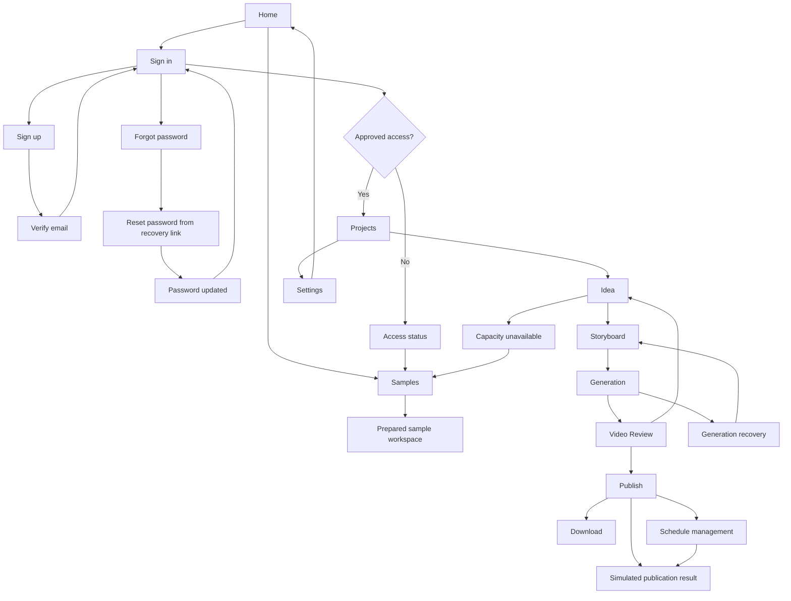

# IdeaMotion complete workflow design

**Superseded for visual approval, 20 October 2026:** The user requested a new Stitch project and complete redesign from the beginning. This document records the rejected canvas and its audit. See [fresh-project brief](STITCH_REBUILD_BRIEF.md) for the replacement work; do not continue repairing or approve the old project.

Requested 19 October 2026. Design source: [existing Stitch project](https://stitch.withgoogle.com/projects/12113627133292675775). These are visual/prototype deliverables, not implemented application routes, authentication, email delivery, generation or posting.

## Screen coverage

Existing: Home, Projects, Idea, Storyboard, Generating, Video Review, Publish. Preserve their approved Violet & Peach theme and four creator stages.

Authentication additions: Sign in, Sign up, Verify email, Forgot password with neutral sent result, Reset password with expired-link repair, Password updated, Access status, Authentication recovery with callback/session-expiry variants.

Remaining workflow additions: Samples gallery, Sample workspace, Settings, Projects empty state, Generation recovery, Capacity unavailable, Schedule management, Simulated publication result, Unavailable page. Use dialogs/inline variants for rename/delete, unsaved changes, version conflict, format rendering/review, schedule confirmation and account connection errors; do not inflate the creator wizard.

## Navigation contract

- Home → Samples → prepared sample workspace → preview/download; all fixture interactions visibly labeled.
- Home → Sign in ↔ Sign up → Verify email → Sign in.
- Sign in → Forgot password → neutral sent result → email link → Reset password → Password updated → Sign in.
- Approved identity → Projects; unapproved identity → Access status → samples/sign out. No client-side self-approval or invented request-access service.
- Projects → Idea → Storyboard approval → Generating → Video Review → Publish/download.
- Video revisions preserve previous output; alternate format requires render and review. Cancel/retry states never imply success.
- Publish → explicit simulation result or saved simulated schedule → schedule detail/cancel/reschedule. Live publishing is conditional; mockups must not imply real posts.
- Settings → identity, timezone, access and Instagram connection state; sign out → Home.
- Failures preserve recoverable input and provide one appropriate next action. Unknown publication outcome offers status checking, not blind retry.

## Completion evidence

The eight authentication screens were generated. The sign-in desktop preview was visually inspected and its inline-error switch was exercised: invalid email and generic credential errors appeared. [Authentication overview](../artifacts/stitch-design/authentication-overview.png). [Sign-in preview](https://stitch.withgoogle.com/preview/12113627133292675775?node-id=b58bac5dcada47e186e15caefc03f8d8).

All nine remaining workflow screens were generated in three smaller batches after Stitch failed the original nine-screen request. The project contains 24 product screen documents plus a Workflow Map Design Board. Stitch reported an auth copy-cleanup pass, but the subsequent saved-document audit still found the old claims. That cleanup is not accepted as complete. Generated mockups require review against the PRD; illustrative claims, invented wording and state behavior are not authoritative implementation contracts.

The [workflow map preview](https://stitch.withgoogle.com/preview/12113627133292675775?node-id=7f4c60789fb44f5987d41a8c33d4cb7e) was inspected for all 24 named pages and public, auth, creator, publishing and fallback branches. Evidence: [map overview](../artifacts/stitch-design/workflow-map.png), [auth flow](../artifacts/stitch-design/authentication-flow.png), [creator flow](../artifacts/stitch-design/creator-workflow.png).

Prototype limitation: in-page scenario switches work, but generated cross-page links remain isolated routing placeholders; complete clickable end-to-end navigation is not verified or claimed. Stitch's Instant Prototype control was also attempted without establishing a connected flow. This does not require a live backend for design purposes, but the current result is a screen suite and navigation map, not a working app. No real signup, email delivery, generation, download integration or social publication was tested. No complete responsive/accessibility audit was performed. Some screen labels still read "Generating Screen..."; four incomplete nodes remain from the failed large batch.

## 20 October audit and repair

The actual rendered DOM of all 24 page documents was inspected, including heading/content inventory, backgrounds, form controls and anchor targets. Raw evidence: `artifacts/stitch-design/audit/page-content.json` and `page-metadata.json`. All expected page types are present, but approval is withheld: several canvas previews are white, Storyboard and Publish retain graphite body backgrounds, almost all cross-page anchors are placeholders, and multiple pages contain excluded features or invented claims (4K, SSO/passkeys, team tools, FPS promises, user counts, support services, fixed recovery expiries, browser-history access and autosave guarantees). Durations/sample counts and technical metadata also drift from the PRD. In-place repair is now underway at the user's request; do not begin the application build or claim the screen suite is approved.
