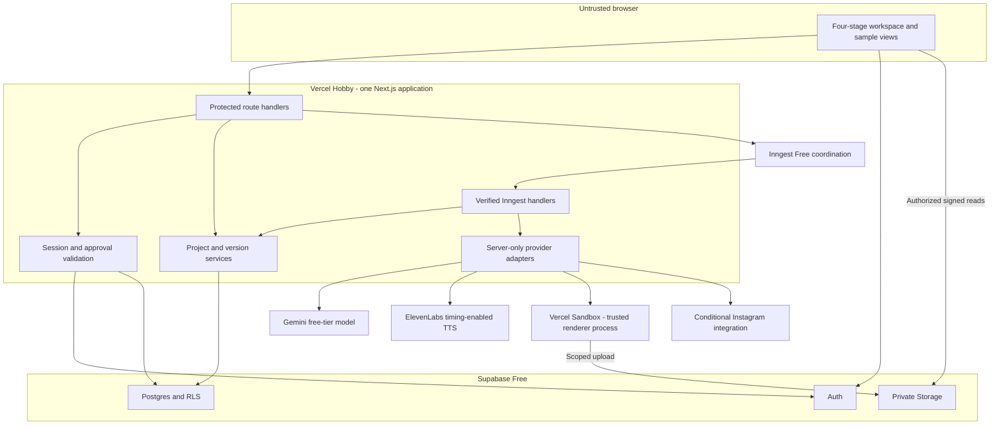
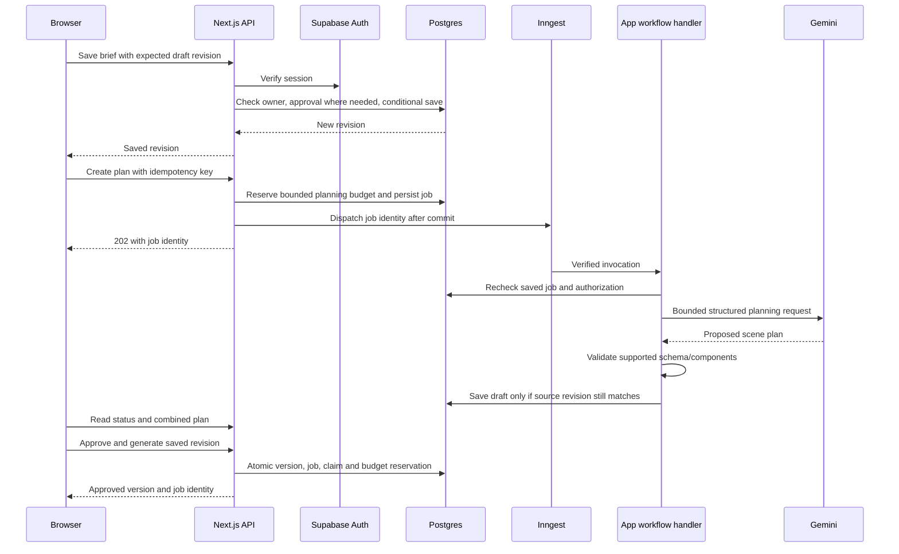
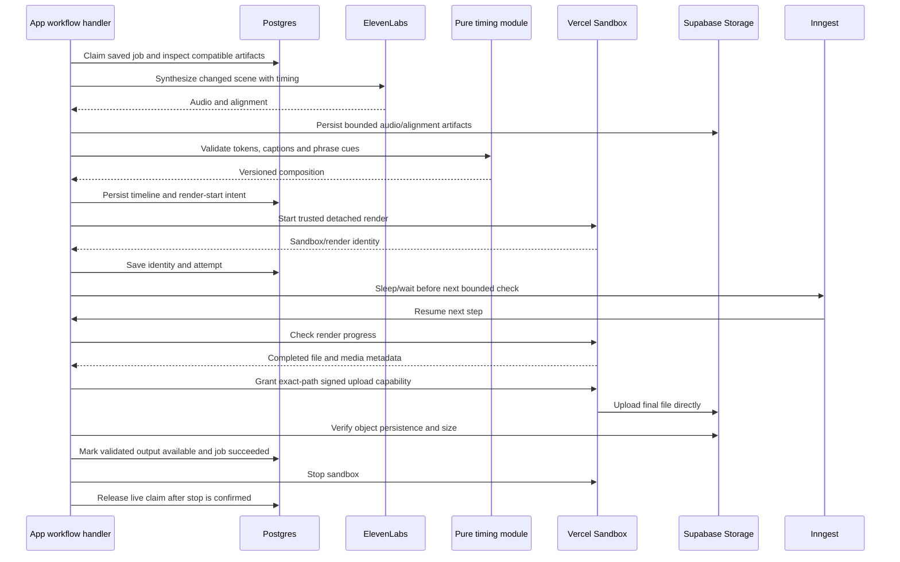
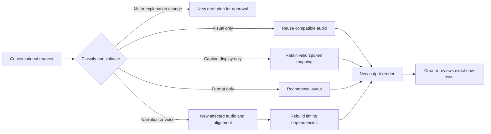
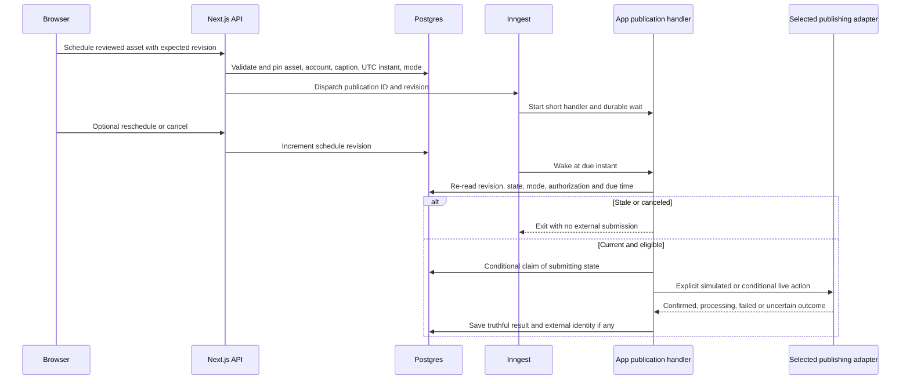

# Detailed system design — AI Educational Explainer Studio

**Version:** 1.0  
**Date:** 19 October 2026  
**Status:** Selected system design. T01 scaffold and T02 shared contracts are implemented; infrastructure/integrations remain unconfigured. See PROGRESS.md.  
**Authority:** [PRD](PRD.md) and latest user instructions  
**Budget:** $0; verified free plans only

## 1. Design outcome

Build one modular Next.js application, deployed on Vercel Hobby, with Supabase Auth/Postgres/Storage, Inngest Free for durable coordination, and Remotion in Vercel Sandbox for hosted rendering. Gemini proposes scene plans. ElevenLabs supplies narration/alignment. Our deterministic logic maps words to captions and visual events.

The public URL supports samples for visitors and quota-limited live creation for approved users. Hosted jobs must not require the developer's laptop online. Local rendering is a development/fallback path. Real Instagram publishing remains conditional on verified access; simulation is explicit.

No microservices, Redis, additional queue, cloud GPU, distributed event store, payment integration, or enterprise platform. The design optimizes understandable state and limited side effects rather than maximum throughput.

## 2. Decisions and tradeoffs

| Decision | Rationale | Tradeoff |
|---|---|---|
| One application and repository | Shared types, simpler deployment/debugging | Jobs must fit short host execution slices |
| Supabase for identity, SQL, and media | Fewer services, relational ownership/transactions, private media | Free project/storage/transfer limits and possible pauses |
| Inngest with short durable steps | Waits/retries without an always-running worker | Execution accounting and host runtime limits still apply |
| Sandbox renderer, not ordinary route encoding | Real browser/media toolchain outside HTTP request lifetime | Requires lifecycle reconciliation and measured compute budget |
| One live production job at a time | Bound exposure and eliminate a scale problem we do not need | Additional creator waits/retries later; no unbounded queue |
| HTTP polling for UI status | Simple, adequate for small portfolio traffic | Modest bounded reads instead of instant push |
| Private object paths and signed access | No public creator buckets or heavy media proxy | Expiring URLs need refresh; signed tokens are bearer access |
| Scene-level reusable artifacts | Revisions can preserve expensive work | Must test voice continuity and dependency hashes |
| Explicit samples and conditional live publishing | Public showcase stays useful within free allowances | Sample results cannot prove live integration |

Numerical product defaults are owned by the PRD. Operational timings below are initial configuration defaults to benchmark, not provider guarantees.

## 3. Deployment and trust boundaries

Browser code receives publishable Supabase configuration, safe DTOs, and scoped read URLs only. Route handlers verify identity/approval rather than trusting middleware, browser metadata, or an owner ID in JSON. Background handlers authenticate Inngest requests, load a persisted authorized job, and recheck its eligibility.

Sandbox runs only trusted application components. It does not execute arbitrary AI code or fetch arbitrary user URLs. Provider keys and broad database credentials are not render props or browser bundle content. See secure media delivery in section 10.

## 4. Modules and dependency direction

| Module | Owns | Must not own |
|---|---|---|
| UI | Interaction, non-sensitive draft state, status display | Approval authority, quota accounting, provider credentials |
| Auth/access | Verified session, approval and ownership checks | Creator-editable approval or enterprise roles |
| Projects/versions | Draft compare-and-swap, immutable plans, artifact review | Provider network calls inside SQL transactions |
| Planning | Gemini adapter, validated plan/revision proposals | Synthesis or arbitrary animation code |
| Narration | ElevenLabs adapter, decoded audio/alignment | Global UI state or final layout |
| Timing | Pure normalization, captions, cue resolution, offsets | Network calls or guessed uniform timestamps |
| Video | Trusted component library, composition, encoder adapter | Identity authorization or model credentials |
| Jobs | Admission, durable steps, state transitions, recovery | A second source of project truth in workflow memory |
| Storage | Constructed paths, scoped upload/read access, cleanup | Unrestricted path signing from user input |
| Publishing | Pinned schedule and live/simulated adapters | Automatic publishing from unreviewed AI output |

Use small interfaces at actual external boundaries: planner, narrator, renderer, publisher. Avoid a generic plugin framework. Pure timing/schema code can be shared by local tests and renderer; provider adapters remain server-only. Detailed directory guidance lives in PRD section 24.

## 5. Persistence model

Postgres is authoritative for identity approval, private project ownership, draft revisions, immutable approved versions, logical jobs/attempts, media references, schedules, and quota reservations. Storage is authoritative for persisted binary existence. Inngest delivery is coordination, not the only record that a job exists.

The ER diagram and constraints live in [database design](DATABASE_SPEC.md). Plans/timelines use bounded validated JSONB or referenced private JSON files; media is never a base64 column. Connection tokens are separate from client-readable projections.

Draft revision, job revision, attempt number, approved content version, schedule revision, and artifact dependency hash are different concepts. Do not reuse one integer for all of them:

- Draft revision detects concurrent editing.
- Approved version identifies immutable content/settings.
- Job revision detects stale user/worker state updates.
- Attempt identifies one bounded retry of the same logical job.
- Schedule revision invalidates stale sleeping runs.
- Dependency key determines whether a source artifact is compatible for reuse.

## 6. Authentication, planning, and approval flow

Planning also uses short background work so slow generation is not a browser timeout dependency. If the creator edits while a planning request runs, do not overwrite the new draft: save the proposal associated with its source revision and return a conflict/review action. The approved version remains immutable.

Check authorization before replaying a saved idempotent result. For an already recorded identical request, replay before reserving new budget, so an exhausted current allowance does not create another reservation or hide the previous result. A different request under the same key is a conflict. Re-approving the same saved snapshot should reuse its approved content version; it must not create unlimited duplicate versions/jobs through different keys.

## 7. Hosted generation sequence

Narration and timing rules belong to [video pipeline](VIDEO_PIPELINE.md). This sequence repeats only for changed scenes and performs no unlimited parallel synthesis. Holds/transitions are included once in global timing.

Store render-start intent before issuing the external call. If a start response is lost, provider reconciliation or needs-attention replaces blind retry. Do not claim exactly-once provider acceptance. Any SDK-side retry must be included in the global attempt/timeout budget; nested SDK and workflow retries can multiply work if left unbounded.

## 8. Job claims, dispatch and cancellation

### Admission

Use a transaction-scoped advisory lock and a database-enforced single live production claim. Claim ownership is a persisted boolean/field on the logical job, not a process-local flag. A partial unique constraint prevents two jobs from holding it. Planning has separate small request/budget limits and cannot create renders through an unapproved route.

Additional expensive submissions return `GENERATION_BUSY` with existing permitted status context; do not create an unlimited queue. An identical idempotent submission returns its existing job. Atomic quota reservations prevent concurrent approved testers from spending the same remaining allowance.

### Dispatch gap

Database commit and Inngest dispatch cannot be one atomic external transaction. Keep `dispatch_pending` in the job, dispatch using stable identity, and expose bounded resume through the job retry action. The handler may have received an event even if the sender timed out, so retry reads/claims the same job. No separate message broker is necessary.

### Content completion versus resource cleanup

A stored validated MP4 can be marked available/succeeded while sandbox shutdown still needs reconciliation. Represent cleanup state separately and retain the live production claim until the previous sandbox is confirmed stopped/non-running. Otherwise another request could start while a supposedly completed renderer still consumes resources.

If stop fails, show the valid output but block new live rendering with a clear internal needs-attention condition. Do not delete a good video or automatically free the claim because its heartbeat aged. Release only on positive provider reconciliation, not an assumed local timeout.

### Cancellation

Record cancel requested and increment job revision. Check before every new external operation and before finalization. Stop an active sandbox where supported; an already running provider call may consume allowance. Do not label canceled until the relevant resource state is reconciled. If completion wins the race, return the completed outcome with truthful cancellation status.

## 9. Revision and artifact reuse sequence

Different approved versions can share compatible source media by reference. A dependency key establishes compatibility; the reused artifact's original owner/project lineage remains unchanged. New composition refers to it rather than relabeling/mutating the original. Review is per final format-specific asset.

Scheduled and published artifacts are pinned. Revision does not replace them. Explicit schedule replacement checks a newly reviewed asset and increments schedule revision.

## 10. Secure media delivery

### Inputs to sandbox

Issue read access only for known validated composition/audio assets in the owned job. URLs expire and are private bearer capabilities, so redact query tokens from logs and Inngest return payloads. Avoid storing them in durable workflow state; store asset IDs and mint at the boundary. If an SDK necessarily persists a narrow capability as a step result, document its TTL/redaction and acceptable access boundary before enabling it.

The trusted Remotion bundle contains public code/assets only. User private narration and project parameters arrive as validated data, not a public bundle. No credential grants arbitrary creator code access to the private bucket.

### Upload from sandbox

Select Supabase's path-specific signed upload mechanism. A short trusted orchestration step creates the upload token immediately before upload and supplies it to the trusted sandbox process over its control API. Do not give the sandbox a project-wide Supabase service credential. Scope token to a server-constructed new asset path and use non-overwriting semantics by default.

The orchestrator checks job/attempt, cancellation, owner and expected destination before granting upload. Supabase's actual signed-token lifetime and upload protocol must be verified during T05; do not assume it is arbitrarily configurable or equivalent to a read URL. If it expires, refresh only for the same authorized pending destination after state verification.

Validate actual encoded bytes/type/duration and configured size cap in the trusted renderer, then verify stored size/path and recorded artifact identity before Ready. A truncated upload is not a completed render. Use durable asset IDs/paths and hashes, not a signed URL, in Postgres.

### Playback/download

Browser requests access by asset ID and purpose. The server authorizes owner/sample status and returns a short-lived read URL with expiry. The browser streams directly from Storage; no Next.js media proxy for full files. Download can refresh access without rendering. For conditional Meta fetching, mint controlled delivery valid for provider processing and expire it afterward.

This design uses existing server routes/handler control, not a new public callback service or generalized capability platform.

## 11. Scheduling and publishing flow

Initial date/late-window policy is in the PRD. Mode is pinned at creation; a simulated run never gains live authority from an environment flag changed later. Free workflow pauses can delay dispatch. Outside the allowed window, require review rather than surprise publication.

Publication retries must preserve the exact submitted render/destination/caption identity. A timeout after possible provider acceptance becomes outcome unknown. Reconcile container/post ID before a new attempt; if the provider cannot establish outcome, require manual destination review. A known rejected input is repairable; an uncertain success is not equivalent to failure.

## 12. Configuration, environments and release compatibility

Use local development, optional preview with fixtures, and one public demo deployment. Preview deployments default to sample mode, have no live publishing credentials, and must not accidentally register duplicate consumers against production jobs. No new paid staging environment is required.

Every job carries contract schema version and attempt. Deploy additive schema changes first; handlers reject unsupported contracts safely. Preserve stable durable step IDs for in-flight supported runs. Do not reuse a step ID for changed side effects or drop tables/fields with active jobs. Freeze new admissions and reconcile jobs before a breaking contract rollout.

Select current compatible package versions during implementation and lock them. Do not pin guessed model identifiers or enable a paid model fallback. Secrets and exact operational budgets are server configuration, not checked-in credentials.

## 13. Performance and quota controls

- UI status polling starts around 5 seconds while visible/running, backs off on errors, and pauses or slows when hidden. Poll terminal jobs only on explicit refresh/access renewal. No WebSocket/Supabase Realtime requirement.
- Render checks initially use durable waits around 15–30 seconds, with a fixed maximum count and total deadline below the configured sandbox session limit. Final values are a T05 benchmark result.
- Set provider call timeouts below host invocation duration, allowing time to persist safe error state. Short syntheses cannot assume unlimited response size/runtime merely because final video is 90 seconds.
- Reserve worst-case configured text units and bounded retry allowance; measure actual consumption. Shared account usage outside this app still requires account-level checks.
- Keep media/file/retention constraints from PRD; disable live work before exhaustion instead of enabling overage. Cleanup and status checks also consume service operations/transfer.
- Samples remain a limited deliberate set with user-initiated playback. A free app cannot promise unlimited public video egress.

## 14. Failure model and recovery ownership

| Failure | Recovery owner | Decision |
|---|---|---|
| Draft conflict | Creator/app UI | Preserve local text; explicit reload/compare |
| Invalid AI plan | Planning adapter | One bounded repair, then actionable failure |
| Invalid speech alignment | Narration/timing | Bounded repair; no guessed synchronization |
| Dispatch response lost | Job coordinator | Same persisted job, idempotent claim/resume |
| Sandbox start/stop uncertain | Renderer adapter | Reconcile provider state; hold claim; no blind new render |
| Artifact upload fails | Storage/coordinator | Retain output where possible; refresh scoped grant/retry within budget |
| Stored asset missing | App/storage | Unavailable state; restore/re-render deliberately, never fake Ready |
| Database unavailable | App/handlers | Fail closed; do not claim saves, reservations or schedule success |
| User approval revoked | Access/coordinator | Stop new external work; preserve authorized private outputs |
| Publishing uncertain | Publishing adapter | Outcome unknown; no blind repost |
| Free quota exhausted | App configuration/owner | Stop affected live work; samples/local fallback, no upgrade |

Recovery actions use existing job endpoints and provider dashboards. A dedicated operations UI, always-running watchdog or enterprise incident platform is not necessary. Logs contain request/job/attempt IDs, stage, safe code, resource references and unit counts, never secret tokens/full private scripts by default.

## 15. Rejected additions

Do not add a separate API service, Celery/Redis queue, generic agent framework, vector database/RAG system, managed GPU, cross-region deployment, paid telemetry, automatic social-content loop, or platform-scale SLA. None is needed to demonstrate this product's stated learning/portfolio goals.

Do not replace safe metadata transactions with eventual in-memory state to appear simpler. Correct ownership, idempotency and cleanup require a few explicit database constraints; they do not require enterprise architecture.

## 16. Validation and next handoff

T01–T04 establish the local shell, contracts, identity/data policies and deterministic rendering. T05 must prove actual hosted narration/timing/render/upload/playback within free accounts. Then build the complete creator UI and revision workflow. [Implementation plan](IMPLEMENTATION_PLAN.md) is authoritative for task order.

Additional design checks before claiming T05 complete: two admissions race safely; uploaded output survives sandbox shutdown; cleanup uncertainty blocks another live render; no broad Storage credential enters sandbox; a repeated event reuses the existing logical job; an expired read URL refreshes; actual provider resource usage/file size is recorded.

Database/API designs are [DATABASE_SPEC.md](DATABASE_SPEC.md) and [API_WORKFLOWS.md](API_WORKFLOWS.md). Tests and evidence are [TESTING_ACCEPTANCE.md](TESTING_ACCEPTANCE.md). No diagram here establishes working deployment or a passing test.

## 17. Official documentation checked for this design

Remotion documents detached rendering with progress checks; this supports the short-step design, subject to integration validation. Supabase documents signed uploads; this supports scoped upload instead of a broad database key inside the renderer. Inngest documents durable sleeps without a running function process and explicitly retains host timeout constraints.

- [Remotion render on Vercel](https://www.remotion.dev/docs/vercel/render-media-on-vercel)
- [Supabase create signed upload URL](https://supabase.com/docs/reference/javascript/storage-from-createsigneduploadurl)
- [Supabase upload to signed URL](https://supabase.com/docs/reference/javascript/file-buckets-uploadtosignedurl)
- [Inngest durable sleep](https://www.inngest.com/docs/durable-execution/primitives/step-sleep)
- [Inngest execution limits](https://www.inngest.com/docs/durable-execution/limits)

